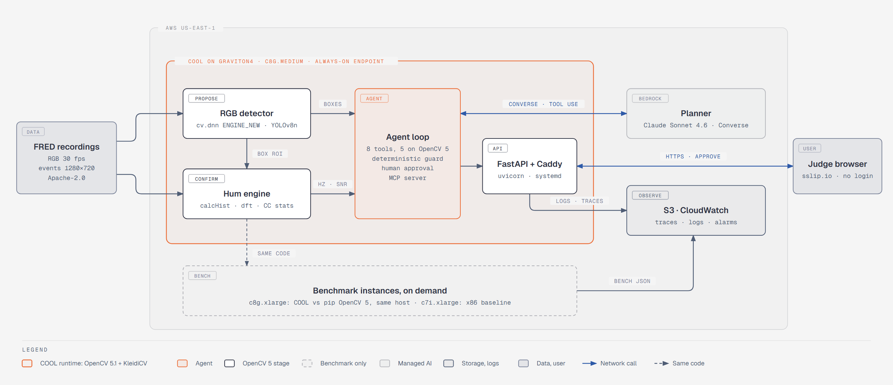

# Strobe

Strobe confirms drones by their propeller hum: an OpenCV 5 detector proposes a box, the event camera inside that box shows a 200 to 750 Hz blade-pass peak that 30 fps video cannot see, and an agent on AWS Graviton decides the next look, the alert, or the question to a human.

- Live endpoint: https://100-27-6-111.sslip.io (no login)
- Technical report: [`docs/REPORT.md`](docs/REPORT.md)
- Architecture: [`docs/architecture.svg`](docs/architecture.svg) · Agent loop: [`docs/agent_workflow.svg`](docs/agent_workflow.svg)
- Video: [X] <!-- fill with the video URL -->



## Try it in 90 seconds

1. Open https://100-27-6-111.sslip.io. Slide 1 plays a real FRED clip of a DJI Mini 2: at 30 fps the propellers are a blur.
2. Slide 2 shows the same drone as raw events in x, y and time. The rotor is a dense, repeating texture.
3. Slide 3 computes the spectrum live on the Graviton server with OpenCV 5 (`calcHist` + `dft`). The drone box peaks near 320 Hz; a box with no drone stays flat.
4. Slide 5 replays the agent: an ambiguous box, a longer window, a frequency map, a hum, a track, then a human approval before the alert. Press approve or reject; the server records your answer and triggers nothing external.
5. Slide 6 shows the measured results.

The same check from a terminal:

```bash
curl -s https://100-27-6-111.sslip.io/version
curl -s -X POST https://100-27-6-111.sslip.io/api/spectrum \
  -H 'content-type: application/json' \
  -d '{"clip":"clear_210","box":[226,324,320,376],"t":20.5,"window_ms":100}'
```

`/version` reports `aarch64` and OpenCV `5.0.0`. The spectrum call returns the drone's peak: on 2026-10-26 it gave 314.3 Hz with a score of 3,013 from 3,781 events, computed in 2.7 ms on the `t4g.small`.

## Measured on FRED (real event + RGB drone recordings)

| Result | Number |
|---|---|
| Hum score, drone box vs random background, AUC (26,911 vs 26,909 test boxes, 47 sequences) | 0.917 |
| Hum score, drone box vs busiest non-drone patch, AUC | 0.758 |
| DJI Mini 2 blade-pass median, Strobe vs published PropPulse estimate | 320 Hz vs 316 Hz |
| Agent with Bedrock planner, 8 pre-registered FRED scenarios | 4 of 8 solved, 0 false alerts (rule planner 2 of 8, 2 false alerts) |
| Graviton4 vs x86, pip OpenCV 5.0.0, 4 threads | faster on 5 of 6 ops, up to 2.06x |
| RGB detector alone vs RGB + hum, false alarms per minute | [X] vs [X] |

Every number, its denominator and its source file are in [`docs/REPORT.md`](docs/REPORT.md).

## Run locally

Python 3.12 or 3.13. All dependencies are pinned.

```bash
pip install -r requirements-dev.txt
uvicorn app.main:app --port 8080
```

Open http://127.0.0.1:8080. The two demo clips ship in `app/data` and `app/static/data`, so no download is needed.

## Tests

```bash
pytest -q
python tools/int64_repro.py
```

`pytest -q` runs 39 tests: the hum engine, the endpoint, the agent guard, and injected planner and tool failures. CI runs them on x86 and Arm (`.github/workflows/ci.yml`). `tools/int64_repro.py` reproduces the OpenCV 5.0.0 int64 truncation we found ([`docs/UPSTREAM_ISSUE_int64.md`](docs/UPSTREAM_ISSUE_int64.md)).

The agent runs offline with the deterministic planners:

```bash
pip install -r strobe/agent/requirements.txt
python eval/agent_eval.py --planners rule,fixed --out runs/agent
```

This needs the FRED event slices from `eval/export_fred_slices.py`. The Bedrock planner (`--planners bedrock`) needs AWS credentials with Bedrock access in us-east-1.

## Deploy on AWS

See [`deploy/README.md`](deploy/README.md). One idempotent command builds or updates the Graviton endpoint:

```bash
python deploy/aws.py web
```

COOL (the Graviton4 Marketplace build of OpenCV 5) runs with `python deploy/aws.py cool`, and `python deploy/aws.py cool-bench` measures COOL against pip OpenCV 5 on the same instance.

## Reproduce the evaluation and benchmarks

- Hum engine on FRED: `strobe/fred_claim.py`, then `strobe/fred_claim_report.py` (report §8.2).
- Known-frequency check: `strobe/known_freq.py` (EEPPR is GPL-3.0 and is downloaded at run time, never committed).
- Detector training and full pipeline: `eval/train_detector/`, `eval/get_fred_eval_data.sh`, `eval/run_eval.py`, `eval/event_only.py` (report §8.3).
- Agent: `eval/export_fred_slices.py`, `eval/agent_eval.py`, scenarios fixed in `eval/scenarios.json` (report §8.4).
- Benchmarks: `python deploy/aws.py bench ...`, `bench/table.py`, `bench/compare.py`; results in `bench/results/` (report §6).

Full commands are in report §12.

## Licence

Apache-2.0, see [`LICENSE`](LICENSE). Third-party code, models and data and their licences are listed in [`THIRD_PARTY.md`](THIRD_PARTY.md). FRED is used under Apache-2.0 per its Hugging Face card. The detector was trained with Ultralytics (AGPL-3.0) in a separate training environment; Strobe's runtime uses only OpenCV.
