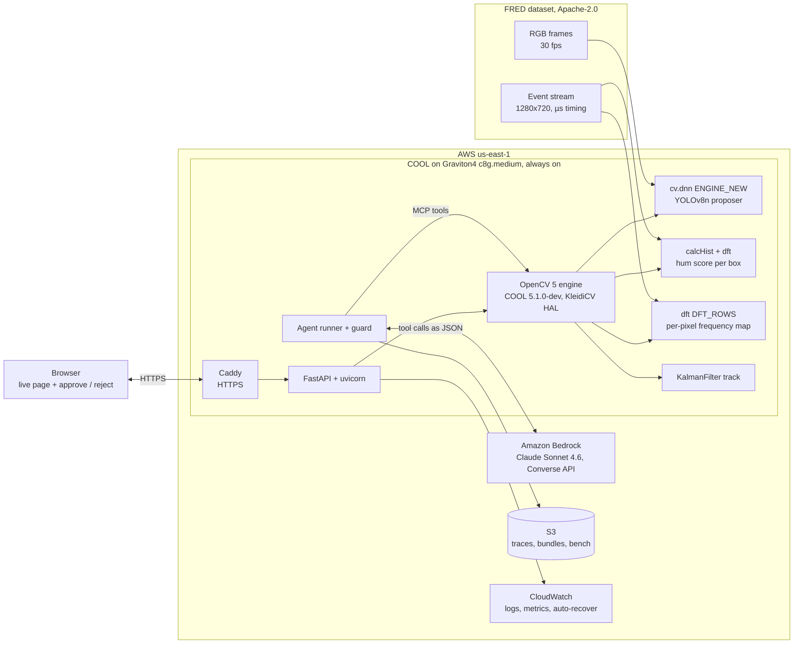
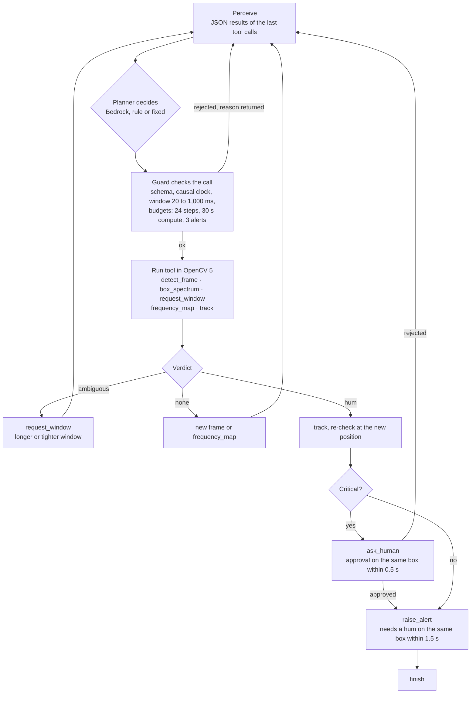

<p align="center">
  <picture>
    <source media="(prefers-color-scheme: dark)" srcset="docs/figures/logo-dark.svg">
    
  </picture>
</p>

<p align="center">
  <b>▶&nbsp;Video:</b> [VIDEO_URL]&nbsp;&nbsp;·&nbsp;&nbsp;<b>Repo:</b> [REPO_URL]&nbsp;&nbsp;·&nbsp;&nbsp;<b>Live:</b> <a href="https://100-27-6-111.sslip.io">100-27-6-111.sslip.io</a> (no login, served by COOL on Graviton4)
</p>

<p align="center">
  
</p>

<h3 align="center">A bird and a drone look the same at 30 fps. Only the drone hums at its blade-pass frequency.</h3>

<p align="center">
  <b>−25% false alarms at the same recall, on 84 minutes of real drone video.</b><br>
  <sub>412.7 → 308.4 false alarms per minute, recall 0.544 → 0.544, FRED test split (47 sequences, every frame). High-precision setting (hum score ≥ 98): precision 0.815 at recall 0.146.</sub>
</p>

<p align="center">
  <a href="https://100-27-6-111.sslip.io"></a><br>
  <sub>The six slides of the live page, captured 2026-10-26: four real FRED drone clips, the hum at 30 fps vs events, the x-y-t event cloud, the spectrum computed on the server, the maths, the agent loop and the results.</sub>
</p>

<p align="center">
  <a href="https://github.com/<owner>/<repo>/actions/workflows/ci.yml">/<repo>/actions/workflows/ci.yml/badge.svg"></a>
</p>

## How Frequency Vision meets the judging criteria

Frequency Vision enters the overall awards and both featured paths: Best Use of COOL and Agentic Vision. Each rubric line below points to its evidence. The same map is machine-readable at [`/api/summary`](https://100-27-6-111.sslip.io/api/summary) under `judging`.

**Overall rubric**

| Criterion (weight) | Evidence | Where |
|---|---|---|
| Technical execution (30%) | OpenCV 5 hum engine (`calcHist`, `dft`, `connectedComponentsWithStats`, `dnn` `ENGINE_NEW`, `KalmanFilter`) on all 47 FRED test sequences: false alarms **412.7 → 308.4 per minute (−25%) at the same recall 0.544**; hum-score AUC 0.917 vs a random patch, 0.758 vs the busiest patch. An OpenCV 5.0.0 int64 defect found and written up for upstream. | `results/detector/results_test.json`, `results/engine/summary.json`, [REPORT §8](docs/REPORT.md), [int64 issue](docs/UPSTREAM_ISSUE_int64.md) |
| Innovation (20%) | The RGB detector proposes. The event camera confirms each box by the propeller's blade-pass frequency, which 30 fps cannot see. An agent picks the next measurement. | Live page slides 1 to 3, [REPORT §13](docs/REPORT.md) |
| Real-world impact (20%) | 8,790 of 34,796 false detections removed while 26 of 70,794 true detections are lost. High-precision setting: precision 0.815. | `results/detector/results_test.json`, [REPORT §1 and §2](docs/REPORT.md) |
| User experience (10%) | Six-slide live page: clip picker, detector run live, spectrum computed live, 3D event cloud, and an agent run live that waits for your Approve or Reject. Keyboard navigation, screen-reader text and a phone layout. | [Live page](https://100-27-6-111.sslip.io), `app/static/` |
| Documentation and presentation (10%) | This README, the technical report, architecture and agent diagrams, figures redrawn from result files, and the video. | [REPORT](docs/REPORT.md), [architecture](docs/architecture.svg), [agent loop](docs/agent_workflow.svg) |
| Cloud delivery, reproducibility, responsible operation (10%) | Always-on COOL endpoint on Graviton4 behind HTTPS, deployed by one script, `/health` and `/version`, rate limits, no SSH, human approval enforced in code. | `deploy/aws.py`, [deploy README](deploy/README.md), [REPORT §5 and §11](docs/REPORT.md) |

**Best Use of COOL**

| Criterion (weight) | Evidence | Where |
|---|---|---|
| Verified COOL integration on Graviton (30%) | The live endpoint loads `cv2` from `/opt/cool`: OpenCV 5.1.0-dev, `aarch64`, KleidiCV HAL. Proof file with instance type, AMI and Marketplace product code. | [`/version`](https://100-27-6-111.sslip.io/version), [COOL proof](#cool-proof) |
| Architecture and technical quality (25%) | COOL serves the page, the hum engine, the detector and the agent tools on one Graviton4 host. Benchmark hosts are separate. | [architecture](docs/architecture.svg), [REPORT §6](docs/REPORT.md) |
| Measured value (20%) | Same Graviton4 host, COOL vs pip OpenCV 5: GaussianBlur **1.89x**, `dft` **1.54x**, connected components **1.17x** faster. Frequency map 1.13x faster end to end, outputs identical. | `bench/results/cool-graviton4-c8g.xlarge.json`, `pip-graviton4-c8g.xlarge-samehost.json`, [`E2E.md`](bench/results/E2E.md) |
| Innovation (15%) | COOL runs signal processing on event-camera time series: a 10 kHz `dft` per box and a per-pixel frequency map with `DFT_ROWS`. | `hertz/freq.py` |
| Reproducibility and demonstration (10%) | `python deploy/aws.py cool` deploys the endpoint. `python deploy/aws.py cool-bench` reruns the same-host benchmark. | [deploy README](deploy/README.md), `bench/` |

**Agentic Vision**

| Criterion (weight) | Evidence | Where |
|---|---|---|
| OpenCV 5 and agent integration (30%) | Every agent tool is an OpenCV 5 call. In trace `late_142` the detector finds nothing, the frequency map finds a 545 Hz spot, and the agent confirms the drone. | `hertz/agent/`, [trace](#one-real-trace-bedrock_late_142) |
| Orchestration and autonomy (25%) | After an ambiguous spectrum the Bedrock planner asked for a new window 6 of 9 times. A guard checks every call against its schema, the clock and the budgets. | `results/agent/eval_v3/results.json`, `hertz/agent/guard.py` |
| Task effectiveness and evaluation (20%) | 8 fixed FRED scenarios: Bedrock **4 of 8 with 0 false alerts**, the same score as the rule planner, with 12.25 vs 17.38 tool calls per episode. | `results/agent/eval_v3/results.json` |
| Failure handling, observability, security, human control (15%) | Critical alerts need a human's approval, enforced by the guard. Injected planner and tool faults are tested. Every step is logged as a JSON line. | `tests/`, `hertz/agent/guard.py`, `POST /api/agent/live` |
| User experience, documentation, demonstration (10%) | Slide 5 replays real traces and runs the agent live on the server with your Approve or Reject. | Live page slide 5, [agent loop](docs/agent_workflow.svg) |

**Submission requirements**

| Requirement | Where it is met |
|---|---|
| OpenCV 5 for substantive image or video analysis | `hertz/freq.py`, `hertz/detect.py`, [`/version`](https://100-27-6-111.sslip.io/version) |
| A meaningful component on AWS | COOL on Graviton4 `c8g.medium` serves the live page and the engine; Amazon Bedrock plans the agent |
| Working web endpoint | [100-27-6-111.sslip.io](https://100-27-6-111.sslip.io) |
| Video, five minutes or less | Video link at the top of this page |
| Technical report | [`docs/REPORT.md`](docs/REPORT.md) |
| Repository with pinned dependencies and build, deploy and test steps | `requirements.txt`, `requirements-dev.txt`, [REPORT §12](docs/REPORT.md), [deploy README](deploy/README.md) |
| Architecture diagram with OpenCV 5, AWS, COOL and agent parts | [`docs/architecture.svg`](docs/architecture.svg), [`docs/agent_workflow.svg`](docs/agent_workflow.svg) |
| Evaluation with failure cases | [Results at a glance](#results-at-a-glance), [REPORT §8 and §9](docs/REPORT.md) |
| Rights to data, models and media | FRED under Apache-2.0, detector weights not distributed, [`THIRD_PARTY.md`](THIRD_PARTY.md) |


<table>
<tr>
<td width="33%"><a href="docs/figures/fig_a_alias.png"></a><br><sub><b>The problem.</b> 316 Hz at 30 fps shows up as 14 Hz.</sub></td>
<td width="33%"><a href="docs/figures/fig_b_events.png"></a><br><sub><b>The signal.</b> Events in the drone box peak at 316 Hz (score 26,656). The busiest non-drone patch scores 8.</sub></td>
<td width="33%"><a href="docs/figures/fig_d_detector.png"></a><br><sub><b>The result.</b> −25% false alarms, 26 of 70,794 true detections lost.</sub></td>
</tr>
</table>

## What it does

Frequency Vision confirms drones by their propeller hum, in three moves:

1. **Look.** An OpenCV 5 DNN detector (YOLOv8n, `cv.dnn.ENGINE_NEW`) proposes boxes in normal 30 fps video.
2. **Listen.** Inside each box, the event-camera stream becomes a 10 kHz time series. `cv.calcHist` + `cv.dft` find the blade-pass peak at 150 to 1,000 Hz, which a 30 fps camera cannot represent.
3. **Decide.** An agent on Amazon Bedrock chooses the next measurement (a longer window, a tighter box, a whole-frame frequency map, a track), raises an alert, or asks a human. A deterministic guard enforces the evidence and approval rules.

Everything runs in OpenCV 5. The live endpoint is COOL, the cloud-optimized OpenCV 5 build, on an AWS Graviton4 `c8g.medium`.

## Results at a glance

All on FRED, a public dataset of real event + RGB drone recordings (Apache-2.0). Thresholds were chosen on train sequences and reported on the 47 test sequences.

| Result | Number | Source |
|---|---|---|
| False alarms per minute, RGB detector vs RGB + hum (151,768 frames, 84.3 min) | **412.7 → 308.4 (−25%)**, recall 0.544 → 0.544, precision 0.670 → 0.731, mAP@0.5 0.505 → 0.516 | `results/detector/results_test.json` |
| False detections removed / true detections lost | **8,790 of 34,796** / 26 of 70,794 | same |
| High-precision setting, RGB + hum score ≥ 98 | precision **0.815** at recall 0.146, 51.2 false alarms per minute | same |
| Hum score AUC, drone box vs random patch / vs busiest non-drone patch (100 ms) | **0.917** / 0.758 (26,911 drone boxes) | `results/engine/summary.json` |
| Blade-pass medians over all test boxes vs PropPulse published medians | DJI Mini 2 **320 Hz (median over all Mini 2 test sequences, 1,951 boxes) vs PropPulse 316 Hz**, Tello EDU 564 vs 539 Hz, Mini 3 245 vs 223 Hz | `results/engine/per_model_youden.json` |
| COOL vs pip OpenCV 5, event-engine ops, same Graviton4 host, 4 threads | GaussianBlur **1.89x**, dft **1.54x**, connectedComponentsWithStats **1.17x** faster under COOL; DNN forward 0.92x | `bench/results/cool-graviton4-c8g.xlarge.json` vs `pip-graviton4-c8g.xlarge-samehost.json` |
| End-to-end confirm step, COOL vs pip, same Graviton4 host, 210 FRED windows | p50 **106.2 vs 98.9 ms** per window (COOL 7% slower, the detector dominates); frequency map **1.13x** faster under COOL; outputs identical | `bench/results/E2E.md`, `e2e-*.json` |
| Graviton4 vs x86 (pip OpenCV 5, 4 vCPUs, 4 threads) | faster on 5 of 6 ops, up to **2.07x** (cvtColor) | `bench/results/pip-graviton4-c8g.xlarge.json`, `pip-x86-c7i.xlarge.json` |
| Agent, 8 pre-registered FRED scenarios | Bedrock **4 / 8, 0 false alerts**, the same score as the hand-tuned rule planner with **30% fewer tool calls** (12.25 vs 17.38 per episode); critical alerts wait for a human (simulated in the evaluation) | `results/agent/eval_v3/results.json` |

Every number, with its denominator, is in [`docs/REPORT.md`](docs/REPORT.md).

## Figures

Every figure is drawn by [`docs/figures/make_figures.py`](docs/figures/make_figures.py) from committed result files and the committed FRED event slices in `app/data/`. Run `python docs/figures/make_figures.py` to redraw them.

### (a) Why 30 fps cannot see the hum


The Mini 2 in the FRED sequence 202 demo clip hums at a median 316 Hz over its 88 windows of 100 ms (`app/static/data/clips.json`). Sampled at 30 fps, it folds to |316 − 11 × 30| = 14 Hz. The middle panel is the real ON-minus-OFF event signal in that drone's box: about 32 blade-pass cycles pass between 3 RGB frames.

### (b) The event cloud and its spectrum


40 ms of FRED events in x, y and time (sequence 202, DJI Mini 2). The drone box (35,540 events) is a periodic stripe. The busiest same-size patch without a drone (476 events) is scatter. Over 100 ms, `freq.box_spectrum` gives the drone box a 315.9 Hz peak with score 26,656 and the patch a score of 8. The live `/api/spectrum` call in [Try it from a terminal](#try-it-from-a-terminal) returns the same 315.9 Hz.

### (c) Hum per drone model vs an independent estimate


Four of five medians land within 10% of PropPulse / DENSE-CUAS on the same dataset. The fast DarwinFPV Cineape20 has weak, scattered peaks, and its wide spread shows it.

### (d) False alarms vs recall for every rule


The train-chosen hum rule (score ≥ 3) keeps recall at 0.544 and removes a quarter of false alarms. Stricter thresholds trade recall for precision along a clean curve, up to precision 0.815 at score ≥ 98 (recall 0.146).

### (e) COOL vs pip, Graviton4 vs x86


COOL speeds up the event engine's own operations: blur 1.89x, `dft` 1.54x and connected components 1.17x. Resize and the DNN forward pass are slower on this COOL build. End to end on 210 real FRED windows (detector, a hum check on each of its 169 boxes, and the full-sensor frequency map), COOL 5.1.0-dev takes p50 106.2 ms per window and pip 5.0.0.93 takes 98.9 ms: the confirm step is 7% slower under COOL. The detector forward pass is most of that time and runs slower under COOL (103.3 vs 95.8 ms). COOL is faster on the event frequency map (1.85 vs 2.08 ms, 1.13x), and the hum checks are equal (0.83 vs 0.80 ms). The outputs are identical: the same 169 boxes, detector scores equal, hum peaks within 0.0001 Hz and no verdict changes. COOL ships 5.1.0-dev and PyPI has no 5.1 wheel, so this comparison cannot separate the COOL build from the 5.0 to 5.1 change. pip OpenCV on Graviton4 beats x86 on 5 of 6 ops; x86 wins the DNN forward pass.

### (f) The agent, and one trace as a timeline


### (g) Known-frequency validation


On 12 EEPPR clips with stated frequencies (1 s window), the pipeline signal (ON minus OFF events per 0.1 ms bin) lands within 2% of the stated frequency on 6 (LED 2,000 Hz, speaker 98 Hz, chain side 28.7 Hz, line 20 Hz, hand spinner 4.7 Hz, spider 3.2 Hz) and at exactly twice it on 3 (screen, motor, velcro side), where each cycle makes two edges. Velcro front reads 100.01 Hz (4.7 times) and dot 78.58 Hz (4.0 times), and chain top is wrong. The plain event-count signal lands within 3% on 7 and at twice the rate on 3. The Prophesee 40 and 50 Hz monitoring clip reads 99.95 Hz (ON minus OFF) and 79.95 Hz (count). Source: `results/engine/known_freq.json`.

| Clip | Stated (Hz) | ON-minus-OFF, the pipeline signal (Hz) | Event count (Hz) |
|---|---|---|---|
| led | 2,000 | 2,000.0 | 1,999.99 |
| screen | 240 | 479.97 | 239.99 |
| speaker | 98 | 97.82 | 195.66 |
| motor | 40 | 79.95 | 79.95 |
| chain_side | 28.7 | 28.23 | 3.82 |
| velcro_side | 26.3 | 52.62 | 52.62 |
| chain_top | 23 | 3.48 | 2.67 |
| velcro_front | 21.1 | 100.01 | 21.1 |
| highcontrastline | 20 | 19.92 | 19.92 |
| highcontrastdot | 19.6 | 78.58 | 19.63 |
| handspinner | 4.7 | 4.65 | 4.58 |
| spider | 3.2 | 3.23 | 3.21 |

### (h) Hum score ROC


## Architecture



The drawn version with the benchmark-only instances is [`docs/architecture.svg`](docs/architecture.svg).

## The agent loop



After **ambiguous**, the Bedrock planner asked for a new window 6 of 9 times. After **none**, it moved to a new frame (6) or searched the whole frame with `frequency_map` (3). After **hum**, it tracked (3) or asked a human (1). Source: `results/agent/eval_v3/results.json`, `summary.bedrock.next_tool_after_verdict`. The drawn version is [`docs/agent_workflow.svg`](docs/agent_workflow.svg).

## One real trace: `bedrock_late_142`

FRED test sequence 142: a DJI Tello EDU enters at 26.0 s and the DNN proposes nothing in three looks. The agent chooses the whole-frame frequency map, finds a 545 Hz spot and confirms a drone the detector missed. Source: [`results/agent/eval_v3/traces/bedrock_late_142.jsonl`](results/agent/eval_v3/traces/bedrock_late_142.jsonl).


**What the agent adds.** On the 8 scenarios, the Bedrock planner ties rules we hand-tuned for these tools (4 / 8, 0 false alerts each) while using 30% fewer tool calls, and it puts every critical alert behind a human approval gate. In the evaluation that approval is a SIMULATED automatic stand-in, labelled in every trace. The agent slide on the live page replays these real traces, and its **Run agent live** button runs the same agent code on the server now: Claude Sonnet 4.6 on Amazon Bedrock (`us.anthropic.claude-sonnet-4-6`, Converse, as in eval_v3) plans on the clip picked at the top (DJI Mini 2 is FRED sequence 202) against the live OpenCV 5 tools. It stops before a critical alert and waits up to 60 s for the visitor's Approve or Reject; with no answer the run ends unconfirmed, waiting for an operator, and no alert is raised. The page names the planner that ran: after 100 Bedrock runs in a UTC day, or on a Bedrock error, the fixed-rule planner takes over. At the end it shows the clip's expected frequency and the IoU of the agent's box with the FRED ground-truth box. One live run per visitor and at most three at once. In the replay, Approve and Reject record the viewer's decision on the server and trigger nothing else. Two earlier development runs on the same scenarios are in `results/agent/dev_runs/`.

## Try it from a terminal

```bash
curl -s https://100-27-6-111.sslip.io/version
curl -s -X POST https://100-27-6-111.sslip.io/api/spectrum \
  -H 'content-type: application/json' \
  -d '{"clip":"clear_mini2_seq202","box":[791,469,917,504],"t":1.767,"window_ms":100}'
```

`/version` reports `"cool": true`, OpenCV `5.1.0-dev` loaded from `/opt/cool`, `aarch64` and the KleidiCV 0.7.0 HAL. On 2026-10-26 the spectrum call returned the Mini 2's peak at 315.9 Hz with a score of 26,655 from 38,845 events, computed in 4.6 ms on the server.

## Technical deep dive

<details>
<summary><b>The maths: Nyquist, the DFT, the score, and why the agent asks for longer windows</b></summary>

**Nyquist and aliasing.** A camera sampling at $f_s$ represents frequencies up to $f_s/2$. At 30 fps that is 15 Hz. A blade-pass tone at $f$ folds to

$$f_{\text{alias}} = \left| f - k f_s \right|,\quad k = \operatorname{round}(f/f_s)$$

For the Mini 2 demo clip, $|316 - 11 \cdot 30| = 14$ Hz. The hum is gone before any model sees it. An event camera timestamps each brightness change in microseconds, so the engine bins events at $f_s = 10$ kHz and the Nyquist limit becomes 5 kHz.

**The signal.** Inside a box, over a window of length $T$, ON and OFF events are binned separately with `cv.calcHist`:

$$x[n] = N_{\text{ON}}[n] - N_{\text{OFF}}[n],\quad n = 0, \dots, N-1,\quad N = T f_s$$

ON-minus-OFF follows the blade edge better than raw counts (drone vs busiest AUC 0.689 vs 0.643 at 100 ms). An Otsu activity mask plus `connectedComponentsWithStats` keeps only the propeller blob (0.753), and a ±6 Hz notch at multiples of 100 Hz removes mains flicker (0.758).

**The DFT.** The mean is removed, a Hann window $w[n]$ applied (`cv.createHanningWindow`), the series zero-padded to an optimal length $M \ge 4N$ (`cv.getOptimalDFTSize`, `cv.copyMakeBorder`), and transformed with `cv.dft`:

$$X[k] = \sum_{n=0}^{N-1} w[n]\,x[n]\,e^{-2\pi i k n / M},\qquad P[k] = |X[k]|^2,\qquad f_k = k f_s / M$$

**The score.** The peak is judged against its own neighbourhood, so a box that is busy everywhere does not win by volume:

$$\text{score} = \max_{f_k \in [150,\,1000]\ \text{Hz}} \frac{P[k]}{\operatorname{median}_{|f_j - f_k| \le 100\ \text{Hz}} P[j]}$$

`cv.minMaxLoc` picks the peak and a parabolic fit on $\log P$ refines it between bins. Thresholds were chosen on FRED train: **score ≥ 98** is a clear hum (5% false alarms on the busiest patch in train), **score ≥ 7.9** is ambiguous (best Youden index).

**Resolution, and why the agent asks for longer windows.** Zero-padding interpolates the spectrum but does not sharpen it. The true resolution is

$$\Delta f = \frac{1}{T}$$

| Window $T$ | $\Delta f$ | Drone vs random AUC | Drone vs busiest AUC |
|---|---|---|---|
| 20 ms | 50 Hz | 0.758 | 0.702 |
| 50 ms | 20 Hz | 0.861 | 0.753 |
| **100 ms** | **10 Hz** | **0.917** | **0.758** |
| 200 ms | 5 Hz | 0.938 | 0.727 |

A steady tone's peak power grows with $T^2$ while broadband noise power grows with $T$, so a longer window lifts a real hum out of the floor. An ambiguous verdict therefore earns a `request_window` with a longer $T$; the trace records `resolution_hz: 5.0` at 200 ms. A drone that changes throttle smears across bins in long windows, so the guard caps $T$ at 1,000 ms and the agent can tighten the box instead. AUCs: `results/engine/summary.json`.

</details>

<details>
<summary><b>OpenCV 5 API used, and what is new in 5.x</b></summary>

| Stage | OpenCV 5 API | New in 5.x? |
|---|---|---|
| Load detector | `cv.dnn.readNetFromONNX(np.uint8 buffer, cv.dnn.ENGINE_NEW)` | **Yes**: `ENGINE_NEW` graph engine |
| Detector pre/post | `cv.dnn.Image2BlobParams`, `blobFromImageWithParams`, `DNN_PMODE_LETTERBOX`, `cv.dnn.NMSBoxes` | No |
| Events to time series | `cv.calcHist` (1-D, relative int32 µs) | No |
| Polarity signal | `cv.subtract`, `cv.mean` | No |
| Spectrum | `cv.createHanningWindow`, `cv.getOptimalDFTSize`, `cv.copyMakeBorder`, `cv.dft(DFT_COMPLEX_OUTPUT)`, `cv.split`, `cv.magnitude` | No |
| Peak pick | `cv.minMaxLoc` on the floor-whitened spectrum | No |
| Per-pixel frequency map | `cv.reduce(REDUCE_AVG)`, `cv.repeat`, `cv.multiply`, `cv.dft(DFT_ROWS)`, up to 20,000 pixels in one call | No |
| Activity mask in a box | `cv.calcHist` (2-D), `cv.GaussianBlur`, `cv.normalize`, `cv.threshold(THRESH_OTSU)`, `cv.connectedComponentsWithStats` | No |
| Event blobs (fallback proposer) | `cv.GaussianBlur`, `cv.threshold`, `cv.morphologyEx(MORPH_CLOSE)`, `cv.connectedComponentsWithStats`, `cv.dilate` | No |
| Tracking | `cv.KalmanFilter`, `cv.moments` | No |
| 64-bit integer Mats | `CV_64S` | **Yes**: 64-bit integer types |
| Proof of build | `cv.getBuildInformation`, `cv.__file__` | KleidiCV HAL is **new in 5.x** |

The ONNX detector in OpenCV 5.0.0 matches PyTorch to 4.6e-4 on box coordinates and 7.5e-7 on scores ([detector ONNX check](results/detector/check_strobe_drone_yolov8n_960x544.json)). The full table with reasons is in [`docs/REPORT.md`](docs/REPORT.md) §4.

</details>

<details>
<summary><b>An OpenCV 5.0.0 defect we found: int64 arrays silently truncated</b></summary>

The Python binding turns a NumPy `int64` array into 32-bit values by keeping the low 32 bits, with no error. Event timestamps are microseconds since an epoch and do not fit in 32 bits.

```bash
python tools/int64_repro.py
```

Output on Windows 11, OpenCV 5.0.0, NumPy 2.4.6, Python 3.13.5:

```
input int64         [1700000000000001, 1700000000000050, 5000000000000]
cv.minMaxLoc        (404635649.0, 658067456.0) expected (5000000000000.0, 1700000000000050.0)
cv.add CV_64S       [809271298, 809271396, 1316134912] expected [3400000000000002, 3400000000000100, 10000000000000]
float64 workaround correct: True | int64 input silently wrong: True
```

The engine subtracts each window's start and passes relative int32 microseconds (`hertz/freq.py`, `_rel_us`). Upstream issue draft: [`docs/UPSTREAM_ISSUE_int64.md`](docs/UPSTREAM_ISSUE_int64.md). One more 5.0.0 trap handled: `readNetFromONNX(bytes)` crashes, so `hertz/detect.py` passes a `np.uint8` buffer.

</details>

<details id="cool-proof">
<summary><b>COOL proof: the workload runs on COOL's OpenCV</b></summary>

Captured through SSM on the benchmark instance (`bench/results/cool-proof-c8g.xlarge.json`):

```
opencv          5.1.0-dev
cv2_file        /opt/cool/python_3.12/site-packages/cv2/__init__.py
machine         aarch64
instance_type   c8g.xlarge
ami_id          ami-033e481a24f94c8cb
product_codes   aajkmdd4qo3r7yhqg61a7aah9
baseline        SVE NEON FP16 NEON_DOTPROD NEON_FP16 NEON_BF16
custom_hal      YES (carotene (ver 0.0.1) KleidiCV (ver 0.7.0))
```

The live endpoint reports the same build on every `GET /version`. COOL vs pip on the same `c8g.xlarge`, p50 ms:

| Op | pip, 4 threads | COOL, 4 threads | COOL speed, 4 threads | COOL speed, 1 thread |
|---|---|---|---|---|
| GaussianBlur | 0.388 | 0.205 | **1.89x** | **2.33x** |
| dft 512×512 | 1.450 | 0.940 | **1.54x** | **1.16x** |
| connectedComponentsWithStats | 0.895 | 0.765 | **1.17x** | 1.02x |
| cvtColor | 0.080 | 0.081 | 0.99x | 1.01x |
| resize | 0.393 | 0.450 | 0.87x | 0.83x |
| DNN forward (YOLOX-S) | 234.1 | 254.8 | 0.92x | 0.95x |

Output differences, COOL vs pip (`bench/results/diff-cool-vs-pip-c8g.xlarge.json`): at most 1 grey level for resize, cvtColor and blur; `dft` maximum difference 9e-8 of the output range; DNN 3.3e-5.

**End to end** ([`bench/results/E2E.md`](bench/results/E2E.md)): on 210 real FRED windows (detector, a hum check on each of its 169 boxes, and the full-sensor frequency map), COOL 5.1.0-dev takes p50 106.2 ms per window and pip 5.0.0.93 takes 98.9 ms: the confirm step is 7% slower under COOL. The detector forward pass is most of that time and runs slower under COOL (103.3 vs 95.8 ms). COOL is faster on the event frequency map (1.85 vs 2.08 ms, 1.13x), and the hum checks are equal (0.83 vs 0.80 ms). The outputs are identical: the same 169 boxes, detector scores equal, hum peaks within 0.0001 Hz and no verdict changes. COOL ships 5.1.0-dev and PyPI has no 5.1 wheel, so this comparison cannot separate the COOL build from the 5.0 to 5.1 change. On the live `c8g.medium` (1 vCPU), `POST /api/detect` runs the detector through `cv.dnn` on COOL in about 403 ms per frame (402.5 to 404.6 ms over 5 calls on 2026-10-26).

</details>

<details>
<summary><b>Reproduce</b></summary>

Python 3.12 or 3.13, pinned dependencies, pip OpenCV 5.0.0 locally. The demo clips ship in `app/data` and `app/static/data`, so the app needs no download.

```bash
pip install -r requirements-dev.txt
pytest -q                      # fresh clone: 39 passed, 0 skipped
python tools/int64_repro.py
uvicorn app.main:app --port 8080
python docs/figures/make_figures.py
```

Hum engine on FRED (Linux, builds the Prophesee ECF decoder):

```bash
sh hertz/ecf/build.sh
python hertz/fred_claim.py <fred_test_root> <out_test> <seq ids...>
python hertz/fred_claim.py <fred_train_root> <out_train> <seq ids...>
python hertz/fred_claim_report.py <out_test> <out_train> summary.json table.csv
python hertz/known_freq.py <eeppr_dir> <monitoring_40_50hz.hdf5> known_freq.json
```

Detector and full pipeline:

```bash
sh eval/get_fred_eval_data.sh
python eval/run_eval.py --onnx <model.onnx> --trainval_root <dir> --test_root <dir> --out <dir>
python eval/event_only.py --trainval_root <dir> --test_root <dir> --out <dir>
```

Agent (`--planners rule,fixed` runs offline; the Bedrock planner needs Bedrock access in us-east-1):

```bash
pip install -r hertz/agent/requirements.txt
python eval/export_fred_slices.py ...
python eval/agent_eval.py --planners rule,fixed --out runs/agent
```

AWS: `python deploy/aws.py cool` launches or updates the COOL endpoint, and `python deploy/aws.py cool-bench` runs the same-host benchmark. See [`deploy/README.md`](deploy/README.md) and [`docs/REPORT.md`](docs/REPORT.md) §12.

</details>

<details>
<summary><b>Repo map</b></summary>

| Path | What |
|---|---|
| `hertz/freq.py` | The hum engine: `box_spectrum`, `frequency_map`, activity mask, score |
| `hertz/detect.py` | OpenCV 5 DNN detector (`ENGINE_NEW`, letterbox, NMS) |
| `hertz/agent/` | Tools, guard, planners (Bedrock, rule, fixed), runner, MCP server, fault injection |
| `hertz/ecf/` | Prophesee ECF decoder build (Apache-2.0) for FRED events |
| `hertz/fred_claim*.py`, `hertz/known_freq.py` | Engine evaluation on FRED and on known-frequency clips |
| `app/` | FastAPI app, live page (`app/static`), demo event slices (`app/data`) |
| `eval/` | Detector training and export, full-pipeline eval, event-only baseline, agent eval, frozen scenarios |
| `bench/` | Benchmark runner, comparisons, price lookup; results in `bench/results/` |
| `deploy/` | AWS launch and update (`aws.py`), instance provisioning |
| `results/` | Every reported number: `detector/`, `engine/`, `agent/eval_v3/` with traces; `agent/dev_runs/` holds two earlier development runs on the same scenarios |
| `tests/` | 39 tests: engine, endpoint, guard, injected planner and tool faults |
| `tools/` | `int64_repro.py`, web export |
| `docs/` | Report, Devpost text, diagrams, figures and their script |

</details>

<details>
<summary><b>Scope and responsible use</b></summary>

**What it is built for.** Frequency Vision confirms detector proposals. The hum is a confirmation signal, not a finder: event-only detection on FRED reaches AP 0.066, so the RGB detector proposes and the agent gathers more windows on ambiguous boxes. The tested setting is FRED: one Prophesee EVK4 sensor in daytime outdoor scenes. Distant drones (box ≤ 30 px) give too few events for a peak, so the agent holds them as unconfirmed (0 of 2 distant scenarios for every planner). Fast FPV drones such as the Cineape20 give weak, scattered peaks (figure c). Mains-driven lights flicker at multiples of 100 Hz; the notch and the whole-frame frequency map handle them, since one frequency filling the whole scene means flicker. The agent evaluation covers 8 fixed scenarios with SIMULATED approval; on the live page a person presses approve or reject.

**Responsible use.**
- Detection and alerting only. It never intercepts, jams or follows a person.
- A critical alert needs a human's approval, enforced by the guard in code, not by the prompt.
- The confirm step uses event timing inside a box, not appearance. The planner receives JSON numbers (boxes, Hz, scores), never images.
- All data shown is the public FRED dataset. Simulated approval is labelled SIMULATED in every trace.
- Thresholds are set on train data with an explicit false-alarm target, because a false drone alarm can halt a runway.
- The endpoint has no SSH, HTTPS only, a least-privilege IAM role, guard-capped agent budgets, and an approval endpoint with input validation and a size cap.

Failure cases with numbers: [`docs/REPORT.md`](docs/REPORT.md) §9.

</details>

<details>
<summary><b>Prior work and how this differs</b></summary>

- **PropPulse / DENSE-CUAS** (github.com/cweekiat/dense-cuas): detects the blade-pass rhythm in FRED events, event-only, with RGB as a rival. Frequency Vision uses RGB to propose and events to confirm inside the box, adds an agent that chooses the next look, and runs in OpenCV 5 on Arm. Its per-model medians are our independent check (figure c).
- **DDHF** (arXiv:2603.08386): event-only drone detection on a GPU; reports failures on edge-on rotors and on wheel spokes and fences. Frequency Vision runs on CPU and pairs the event check with an RGB proposal and a whole-frame frequency map that separates a rotor from scene-wide periodic texture.
- **Stewart et al., event-based virtual fence** (doi:10.1145/3546790.3546800): detects drones crossing a virtual boundary from the propeller signature. Frequency Vision confirms detector proposals box by box and lets an agent choose the next measurement.

We found no prior system that combines an RGB proposer, an event-frequency confirmation inside the box, and an agent that chooses the next measurement.

</details>

<details>
<summary><b>Licences</b></summary>

Apache-2.0, see [`LICENSE`](LICENSE). Third-party code, models and data are listed in [`THIRD_PARTY.md`](THIRD_PARTY.md). FRED is used under Apache-2.0 per its Hugging Face card. EEPPR is GPL-3.0 and is downloaded at run time, never committed. The Prophesee sample recording is CC0. The detector weights were trained with Ultralytics (AGPL-3.0) in a separate training environment and are not distributed; the runtime uses only OpenCV.

</details>

---

Technical report: [`docs/REPORT.md`](docs/REPORT.md) · Architecture: [`docs/architecture.svg`](docs/architecture.svg) · Agent loop: [`docs/agent_workflow.svg`](docs/agent_workflow.svg) · The code package is `hertz`.
