<p align="center"><b>Proud submission to the OpenCV AI Competition 2026 (powered by AWS)</b></p>

<p align="center">
  
  
  
  
  
  
  <a href="LICENSE"></a>
  <a href="https://100-27-6-111.sslip.io"></a>
  <a href="https://github.com/Yazan-O/frequency-vision/actions/workflows/ci.yml"></a>
</p>

<p align="center">
  <picture>
    <source media="(prefers-color-scheme: dark)" srcset="docs/figures/logo-dark.svg">
    
  </picture>
</p>

<p align="center">
  <b>▶&nbsp;Video:</b> <a href="https://youtu.be/KSkdlCEsu84">youtu.be/KSkdlCEsu84</a>&nbsp;&nbsp;·&nbsp;&nbsp;<b>Repo:</b> <a href="https://github.com/Yazan-O/frequency-vision">github.com/Yazan-O/frequency-vision</a>&nbsp;&nbsp;·&nbsp;&nbsp;<b>Live:</b> <a href="https://100-27-6-111.sslip.io">100-27-6-111.sslip.io</a> (no login, served by COOL on Graviton4)<br>
  <b>Team:</b> Mohamad Yazan Sadoun, PhD candidate, Electrical and Computer Engineering, University of Oklahoma
</p>

<p align="center">
  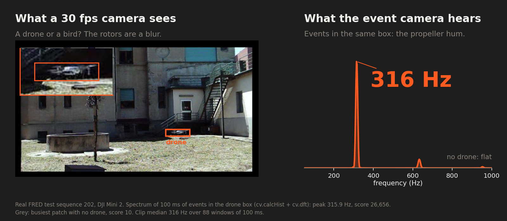
</p>

<h3 align="center">A bird and a drone look the same at 30 fps. Only the drone hums at its blade-pass frequency.</h3>

<p align="center">
  <b>−25% false alarms at the same recall, on 84 minutes of real drone video.</b><br>
  <sub>Precision 0.670 → 0.731. False boxes summed over every frame: 412.7 → 308.4 per minute of video (0.23 → 0.17 per frame), recall 0.544 → 0.544, FRED test split (47 sequences, every frame). High-precision setting (hum score ≥ 98): precision 0.815 at recall 0.146.</sub>
</p>

<p align="center">
  <b>An agent on Amazon Bedrock whose decisions come from OpenCV 5 vision.</b> Bedrock gets 12 of 24 scenarios right (6 of 18 drones confirmed, 6 of 6 empty scenes cleared, 0 false alerts). With its spectrum blinded it gets 6 of 24 and confirms 0 of 18.<br>
  <b>Live on COOL on AWS Graviton4, verifiable in one click:</b> <a href="https://100-27-6-111.sslip.io/api/cool"><code>/api/cool</code></a>, or the <b>Verify COOL live</b> button on slide 6.
</p>

<p align="center">
  <a href="https://100-27-6-111.sslip.io">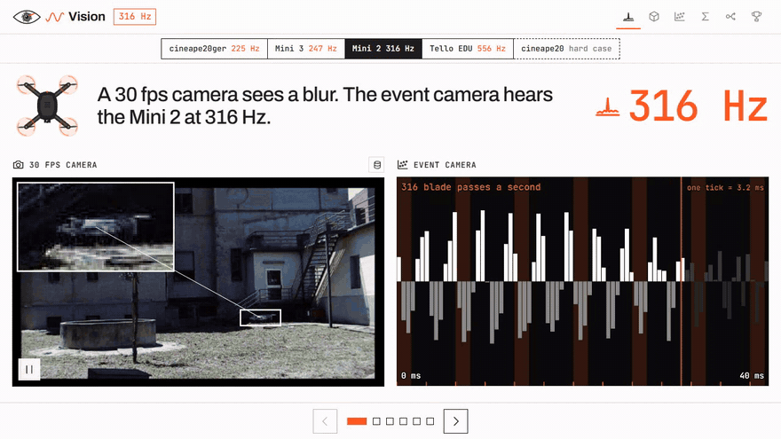</a><br>
  <sub>The six slides of the live page, captured 2026-10-26: four drone clips in the picker, the hum at 30 fps vs events, the x-y-t event cloud, the spectrum computed on the server, the maths, the agent loop and the results.</sub>
</p>

Frequency Vision confirms drones by their propeller hum, in three moves:

1. **Look.** An OpenCV 5 DNN detector (YOLOv8n, `cv.dnn.ENGINE_NEW`) proposes boxes in normal 30 fps video.
2. **Listen.** Inside each box, the event-camera stream becomes a 10 kHz time series. `cv.calcHist` and `cv.dft` find the blade-pass peak at 150 to 1,000 Hz, which a 30 fps camera cannot represent.
3. **Decide.** An agent on Amazon Bedrock chooses the next measurement (a longer window, a tighter box, a whole-frame frequency map, a track), raises an alert, or asks a human. A deterministic guard enforces the evidence and approval rules.

All image and event work runs in OpenCV 5. The live endpoint runs COOL, the cloud-optimized OpenCV 5 build, on an AWS Graviton4 `c8g.medium`.

## What judges asked for

Frequency Vision meets every final submission requirement and enters the overall awards and both featured paths: Best Use of COOL and Agentic Vision. Each line below links to its evidence. The same map is machine-readable at [`/api/summary`](https://100-27-6-111.sslip.io/api/summary) under `judging`.

### Submission requirements

| Requirement | Evidence |
|---|---|
| OpenCV 5 for substantive image or video analysis | [`hertz/freq.py`](hertz/freq.py), [`hertz/detect.py`](hertz/detect.py), live [`/version`](https://100-27-6-111.sslip.io/version) |
| A meaningful component on AWS | COOL on Graviton4 `c8g.medium` serves the page, the engine and the agent tools; Amazon Bedrock plans the agent ([deploy README](deploy/README.md)) |
| Technical report: problem, users, architecture, OpenCV 5, AWS, evaluation, limitations, responsible use | [`docs/REPORT.md`](docs/REPORT.md) §1 to §11 |
| Judge-accessible code repository | [github.com/Yazan-O/frequency-vision](https://github.com/Yazan-O/frequency-vision), public |
| Pinned dependencies, build, deployment and test instructions | [`requirements.txt`](requirements.txt), [`requirements-dev.txt`](requirements-dev.txt), [Reproduce](#reproduce), [deploy README](deploy/README.md), [CI](.github/workflows/ci.yml) |
| Architecture diagram with OpenCV 5, AWS, COOL and agent parts | [Architecture](#architecture), [`docs/architecture.svg`](docs/architecture.svg), [`docs/agent_workflow.svg`](docs/agent_workflow.svg) |
| Working web endpoint | [100-27-6-111.sslip.io](https://100-27-6-111.sslip.io), always on |
| Video of five minutes or less: team, app working, architecture, results | [https://youtu.be/KSkdlCEsu84](https://youtu.be/KSkdlCEsu84) |
| Evaluation evidence with failure cases and limitations | [Results](#results), [REPORT §8 to §10](docs/REPORT.md) |
| Best Use of COOL evidence: COOL version, instance config, reproducible method, proof COOL runs the workload | [COOL page for judges](docs/COOL.md), [COOL on Graviton4](#cool-on-graviton4), [live host proof `c8g.medium`](bench/results/cool-proof-live-c8g.medium.json), [benchmark host proof `c8g.xlarge`](bench/results/cool-proof-c8g.xlarge.json) |
| Agentic Vision evidence: workflow diagram, a trace where OpenCV 5 output changes the next action, evaluation of success, failures and human control | [The agent](#the-agent), [trace `bedrock_late_142`](results/agent/eval_v4/traces/bedrock_late_142.jsonl), [`results/agent/eval_v4/results.json`](results/agent/eval_v4/results.json), [`vision_ablation.json`](results/agent/eval_v4/vision_ablation.json), [fault table](results/agent/faults/TABLE.md) |
| Rights to data, models and media | FRED under Apache-2.0, detector weights not distributed, [`THIRD_PARTY.md`](THIRD_PARTY.md) |

### Overall rubric

| Criterion (weight) | Evidence | Where |
|---|---|---|
| Technical execution (30%) | OpenCV 5 hum engine and DNN detector on every frame of all 47 FRED test sequences: false alarms **412.7 → 308.4 per minute (−25%) at the same recall 0.544**. Hum-score AUC 0.917 vs a random patch, 0.758 vs the busiest patch. An OpenCV 5.0.0 int64 binding defect found and written up for upstream. | [`results/detector/results_test.json`](results/detector/results_test.json), [`results/engine/summary.json`](results/engine/summary.json), [int64 issue](docs/UPSTREAM_ISSUE_int64.md) |
| Innovation (20%) | The RGB detector proposes. The event camera confirms each box by the propeller's blade-pass frequency, which 30 fps cannot see. An agent picks the next measurement. | [How the hum engine works](#how-the-hum-engine-works), [REPORT §13](docs/REPORT.md) |
| Real-world impact (20%) | Users: airport, prison and venue security teams and counter-drone integrators. Reported drone sightings closed Gatwick's runway for about 33 hours in December 2018 (REPORT §1). 8,790 of 34,796 false detections removed while 26 of 70,794 true detections are lost. | [`results/detector/results_test.json`](results/detector/results_test.json), [REPORT §1 and §2](docs/REPORT.md) |
| User experience (10%) | Six-slide live page: clip picker, detector run live, spectrum computed live, 3D event cloud, and a live agent run that waits for your Approve or Reject. Keyboard navigation, screen-reader text and a phone layout. | [Live page](https://100-27-6-111.sslip.io), [`app/static/`](app/static/deck.html) |
| Documentation and presentation (10%) | This README, the technical report, architecture and agent diagrams, figures drawn from committed result files, and the video. | [REPORT](docs/REPORT.md), [figures script](docs/figures/make_figures.py) |
| Cloud delivery, reproducibility, responsible operation (10%) | Always-on COOL endpoint on Graviton4 behind HTTPS, deployed by one script, `/health` and `/version`, CloudWatch logs and auto-recover, rate limits, no SSH, human approval enforced in code. | [`deploy/aws.py`](deploy/aws.py), [deploy README](deploy/README.md), [REPORT §5 and §11](docs/REPORT.md) |

### Best Use of COOL rubric

| Criterion (weight) | Evidence | Where |
|---|---|---|
| Verified COOL integration on Graviton (30%) | The live endpoint loads `cv2` from `/opt/cool`: OpenCV 5.1.0-dev, `aarch64`, KleidiCV 0.7.0 HAL. A proof file records the instance type, AMI and Marketplace product code. | live [`/version`](https://100-27-6-111.sslip.io/version), [COOL proof](#cool-on-graviton4) |
| Architecture and technical quality (25%) | COOL serves the page, the hum engine, the detector and the agent tools on one Graviton4 host. Benchmark hosts are separate and terminated after each run. | [Architecture](#architecture), [COOL call map](docs/COOL.md#1-why-event-camera-signal-processing-suits-cool), [`docs/cool_architecture.svg`](docs/cool_architecture.svg), [REPORT §6](docs/REPORT.md) |
| Measured value (20%) | Per 1,000 windows of the full confirm step, Graviton4 with COOL costs 0.00297 USD against 0.00423 to 0.00441 USD on x86 c7i.xlarge, 30 to 33% less (EC2 on-demand). The event frequency map runs 1.26x faster than pip on the same host at 100 ms of events and 1.45x at 500 ms, with identical outputs. Single ops: GaussianBlur **1.89x**, `dft` **1.54x**, connected components **1.17x**. | [`cool-graviton4-c8g.xlarge.json`](bench/results/cool-graviton4-c8g.xlarge.json), [`pip-graviton4-c8g.xlarge-samehost.json`](bench/results/pip-graviton4-c8g.xlarge-samehost.json), [`E2E.md`](bench/results/E2E.md) |
| Innovation (15%) | COOL runs signal processing on event-camera time series: a 10 kHz `dft` per box and a per-pixel frequency map with `DFT_ROWS`. | [`hertz/freq.py`](hertz/freq.py) |
| Reproducibility and demonstration (10%) | `python deploy/aws.py cool --type c8g.medium` deploys the endpoint. `python deploy/aws.py cool-bench --name strobe-cool-bench` reruns the same-host benchmark on its own instance. | [deploy README](deploy/README.md), [`bench/`](bench/bench.py) |

### Agentic Vision rubric

| Criterion (weight) | Evidence | Where |
|---|---|---|
| OpenCV 5 and agent integration (30%) | Every vision tool is an OpenCV 5 call. In trace `late_142` the detector finds nothing, the frequency map finds a 545 Hz spot, and the agent confirms the drone. | [`hertz/agent/`](hertz/agent/tools.py), [trace](#one-real-trace-bedrock_late_142) |
| Orchestration and autonomy (25%) | Blind the OpenCV spectrum and Bedrock falls from 12 to 6 of 24, finding 0 of 18 drones. With the same history, a blinded result changes its next action at 39 of 130 vision steps (30%), a shuffled result at 53 of 130 (41%), and at all 10 steps that followed a hum verdict. A guard checks every call against its schema, the clock and the budgets. The same guarded tools are an MCP server. | [`vision_ablation.json`](results/agent/eval_v4/vision_ablation.json), [`SUMMARY.json`](results/agent/eval_v4/SUMMARY.json), [`hertz/agent/guard.py`](hertz/agent/guard.py), [`hertz/agent/mcp_server.py`](hertz/agent/mcp_server.py) |
| Task effectiveness and evaluation (20%) | 24 FRED scenarios, 16 of them held out and never used for any fix: Bedrock **12 of 24 with 0 false alerts**, against 10 (1 false alert) for the rule planner and 9 for a fixed schedule. On the held-out 16: 8 vs 6 vs 6. | [`results/agent/eval_v4/results.json`](results/agent/eval_v4/results.json), [`eval/scenarios.json`](eval/scenarios.json) |
| Failure handling, observability, security, human control (15%) | Critical alerts need a human's approval, enforced by the guard: operator reject, timeout and approve each held in 6 of 6 Bedrock episodes that asked (operator scripted in the evaluation). After a Reject, every alert is blocked until a later approval. 21 cases, 20 injected faults (planner, tools, data, budgets, operator, MCP) plus a no-fault control: **21 of 21 handled, 0 unsafe alerts**. Every step is logged as a JSON line. | [`results/agent/faults/TABLE.md`](results/agent/faults/TABLE.md), [`tests/test_agent_faults.py`](tests/test_agent_faults.py), [`hertz/agent/guard.py`](hertz/agent/guard.py) |
| User experience, documentation, demonstration (10%) | Slide 5 replays real traces and runs the agent live on the server with your Approve or Reject. | [Live page](https://100-27-6-111.sslip.io) slide 5, [agent loop](docs/agent_workflow.svg) |

## Architecture

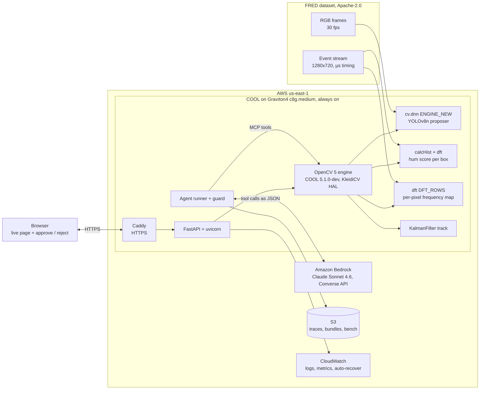

The drawn version, with the benchmark-only instances, is [`docs/architecture.svg`](docs/architecture.svg).

## How the hum engine works

<table>
<tr>
<td width="50%">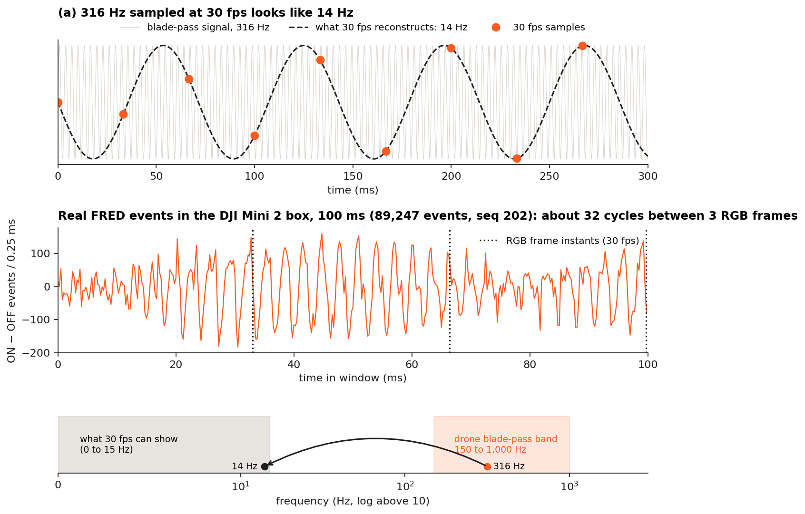<br><sub><b>The problem.</b> The Mini 2 in FRED sequence 202 hums at a median 316 Hz over its 88 windows of 100 ms. Sampled at 30 fps it folds to |316 − 11 × 30| = 14 Hz.</sub></td>
<td width="50%">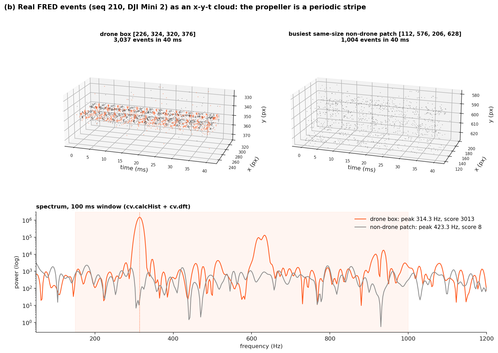<br><sub><b>The signal.</b> 40 ms of events: the drone box (35,540 events) is a periodic stripe, the busiest drone-free patch (476 events) is scatter. Over 100 ms the drone box peaks at 315.9 Hz with score 26,656; the patch scores 8.</sub></td>
</tr>
</table>

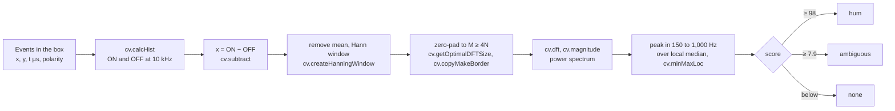

<details>
<summary><b>The maths: binning, ON−OFF, Hann window, <code>cv.dft</code>, peak over median, and why the agent asks for longer windows</b></summary>

**Nyquist and aliasing.** A camera sampling at $f_s$ represents frequencies up to $f_s/2$. At 30 fps that is 15 Hz. A blade-pass tone at $f$ folds to

$$f_{\text{alias}} = \left| f - k f_s \right|,\quad k = \operatorname{round}(f/f_s)$$

For the Mini 2 demo clip, $|316 - 11 \cdot 30| = 14$ Hz. The hum is gone before any model sees it. An event camera timestamps each brightness change in microseconds, so the engine bins events at $f_s = 10$ kHz and the Nyquist limit becomes 5 kHz.

**Binning and the signal.** Inside a box, over a window of length $T$, ON and OFF events are binned separately with `cv.calcHist`:

$$x[n] = N_{\text{ON}}[n] - N_{\text{OFF}}[n],\quad n = 0, \dots, N-1,\quad N = T f_s$$

ON-minus-OFF follows the blade edge better than raw counts (drone vs busiest AUC 0.689 vs 0.643 at 100 ms). An Otsu activity mask plus `connectedComponentsWithStats` keeps only the propeller blob (0.753), and a ±6 Hz notch at multiples of 100 Hz removes mains flicker (0.758).

**The DFT.** The mean is removed, a Hann window $w[n]$ applied (`cv.createHanningWindow`), the series zero-padded to an optimal length $M \ge 4N$ (`cv.getOptimalDFTSize`, `cv.copyMakeBorder`), and transformed with `cv.dft`:

$$X[k] = \sum_{n=0}^{N-1} w[n]\,x[n]\,e^{-2\pi i k n / M},\qquad P[k] = |X[k]|^2,\qquad f_k = k f_s / M$$

**Peak over median.** The peak is judged against its own neighbourhood, so a box that is busy everywhere does not win by volume:

$$\text{score} = \max_{f_k \in [150,\,1000]\ \text{Hz}} \frac{P[k]}{\operatorname{median}_{|f_j - f_k| \le 100\ \text{Hz}} P[j]}$$

`cv.minMaxLoc` picks the peak and a parabolic fit on $\log P$ refines it between bins. Thresholds were chosen on FRED train: **score ≥ 98** is a clear hum (5% false alarms on the busiest patch in train), **score ≥ 7.86** is ambiguous (best Youden index; the agent rounds it to 7.9).

**Resolution, and why the agent asks for longer windows.** Zero-padding interpolates the spectrum but does not sharpen it. The true resolution is

$$\Delta f = \frac{1}{T}$$

| Window $T$ | $\Delta f$ | Drone vs random AUC | Drone vs busiest AUC |
|---|---|---|---|
| 20 ms | 50 Hz | 0.758 | 0.702 |
| 50 ms | 20 Hz | 0.861 | 0.753 |
| **100 ms** | **10 Hz** | **0.917** | **0.758** |
| 200 ms | 5 Hz | 0.938 | 0.727 |

A steady tone's peak power grows with $T^2$ while broadband noise power grows with $T$, so a longer window lifts a real hum out of the floor. An ambiguous verdict therefore earns a `request_window` with a longer $T$; the trace records `resolution_hz: 5.0` at 200 ms. A drone that changes throttle smears across bins in long windows, so the guard caps $T$ at 1,000 ms and the agent can tighten the box instead. AUCs: [`results/engine/summary.json`](results/engine/summary.json).

</details>

<details>
<summary><b>OpenCV 5 API used, and what is new in 5.x</b></summary>

| Stage | OpenCV 5 API | New in 5.x? |
|---|---|---|
| Load detector | `cv.dnn.readNetFromONNX(np.uint8 buffer, cv.dnn.ENGINE_NEW)` | **Yes**: `ENGINE_NEW` graph engine |
| Detector pre/post | `cv.dnn.Image2BlobParams`, `blobFromImageWithParams`, `DNN_PMODE_LETTERBOX`, `cv.dnn.NMSBoxes` | No |
| Events to time series | `cv.calcHist` (1-D, relative int32 µs) | No |
| Polarity signal | `cv.subtract`, `cv.mean` | No |
| Spectrum | `cv.createHanningWindow`, `cv.getOptimalDFTSize`, `cv.copyMakeBorder`, `cv.dft(DFT_COMPLEX_OUTPUT)`, `cv.split`, `cv.magnitude` | No |
| Peak pick | `cv.minMaxLoc` on the floor-whitened spectrum | No |
| Per-pixel frequency map | `cv.reduce(REDUCE_AVG)`, `cv.repeat`, `cv.multiply`, `cv.dft(DFT_ROWS)`, up to 20,000 pixels in one call | No |
| Activity mask in a box | `cv.calcHist` (2-D), `cv.GaussianBlur`, `cv.normalize`, `cv.threshold(THRESH_OTSU)`, `cv.connectedComponentsWithStats` | No |
| Event blobs (fallback proposer) | `cv.GaussianBlur`, `cv.threshold`, `cv.morphologyEx(MORPH_CLOSE)`, `cv.connectedComponentsWithStats`, `cv.dilate` | No |
| Tracking | `cv.KalmanFilter`, `cv.moments` | No |
| 64-bit integer Mats | `CV_64S` | **Yes**: 64-bit integer types |
| Proof of build | `cv.getBuildInformation`, `cv.__file__` | KleidiCV HAL is **new in 5.x** |

The full table with the reason for each API is in [`docs/REPORT.md`](docs/REPORT.md) §4.

</details>

<details>
<summary><b>An OpenCV 5.0.0 defect we found: int64 arrays silently truncated</b></summary>

The Python binding turns a NumPy `int64` array into 32-bit values by keeping the low 32 bits, with no error. Event timestamps are microseconds since an epoch and do not fit in 32 bits.

```bash
python tools/int64_repro.py
```

Output on Windows 11, OpenCV 5.0.0, NumPy 2.4.6, Python 3.13.5:

```
input int64         [1700000000000001, 1700000000000050, 5000000000000]
cv.minMaxLoc        (404635649.0, 658067456.0) expected (5000000000000.0, 1700000000000050.0)
cv.add CV_64S       [809271298, 809271396, 1316134912] expected [3400000000000002, 3400000000000100, 10000000000000]
float64 workaround correct: True | int64 input silently wrong: True
```

The engine subtracts each window's start and passes relative int32 microseconds (`hertz/freq.py`, `_rel_us`). Upstream issue write-up with its repro: [`docs/UPSTREAM_ISSUE_int64.md`](docs/UPSTREAM_ISSUE_int64.md). One more 5.0.0 trap handled: `readNetFromONNX(bytes)` crashes, so `hertz/detect.py` passes a `np.uint8` buffer.

</details>

## The detector

[`hertz/detect.py`](hertz/detect.py) runs a YOLOv8n drone detector fine-tuned on FRED train RGB frames for 10 epochs (validation mAP@0.5 0.577 on held-out train sequences, [`train_results.csv`](results/detector/train_results.csv)). It is exported to ONNX at 960×544 and run by the OpenCV 5 DNN engine (`cv.dnn.ENGINE_NEW`) with letterbox preprocessing and `cv.dnn.NMSBoxes`, at score ≥ 0.125 chosen on train. In OpenCV 5.0.0 the ONNX output matches PyTorch to 4.6e-4 on box coordinates and 7.5e-7 on scores ([ONNX check](results/detector/check_strobe_drone_yolov8n_960x544.json)). The median time per frame is 97.8 ms with 2 CPU threads; on the live 1-vCPU `c8g.medium` under COOL, `POST /api/detect` takes about 403 ms. The weights are not distributed; [`THIRD_PARTY.md`](THIRD_PARTY.md) gives the retrain steps.

<p align="center">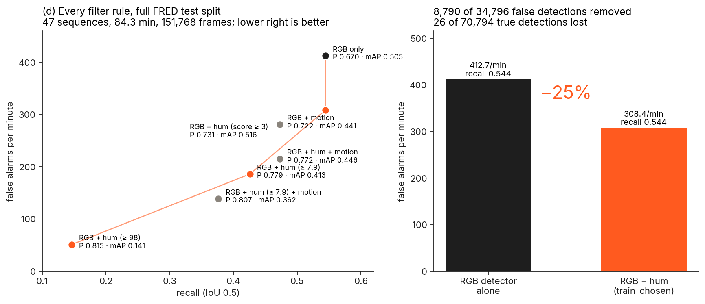</p>

The train-chosen hum rule (score ≥ 3) keeps recall at 0.544 and removes a quarter of the false alarms. The headline filter keeps a box when its hum score is 3 or more, a bar chosen on train sequences to keep recall. The agent's verdicts use the stricter bars: 7.9 for ambiguous and 98 for hum. Raising the threshold raises precision to 0.815 and lowers recall to 0.146.

## The agent

The agent runs a perception, decision and action loop. At each step the planner reads the JSON results of its last tool calls and picks the next call. Three planners share the same tools and guard: Claude Sonnet 4.6 on Amazon Bedrock (Converse API), a hand-written rule planner, and a fixed schedule.

| Tool | OpenCV 5 work | What it returns |
|---|---|---|
| `detect_frame` | `cv.dnn` detector, event blobs (`connectedComponentsWithStats`) as a labelled fallback | candidate boxes |
| `box_spectrum` | `calcHist` + `dft` in a box over a window | peak Hz, score, verdict hum / ambiguous / none |
| `request_window` | the same, with a longer or tighter window ending now | new spectrum and how it changed |
| `frequency_map` | per-pixel `dft(DFT_ROWS)` over the frame | humming spots the detector missed, and whether one frequency fills the scene (flicker) |
| `track` | `KalmanFilter` on event centroids | end box, velocity, lost or not |
| `ask_human` | none | operator approve or reject |
| `raise_alert` | none | alert record |
| `finish` | none | episode verdict |

- **MCP.** [`hertz/agent/mcp_server.py`](hertz/agent/mcp_server.py) (`mcp==1.26.0`) exposes the same tools to any MCP client, and every call still passes the guard. `ask_human` uses MCP elicitation and denies by default when no operator answers. Run it with `python -m hertz.agent.mcp_server`.
- **Guard.** [`hertz/agent/guard.py`](hertz/agent/guard.py) checks every call before it runs: argument schema, boxes clipped to the frame, a causal clock (no window may end in the future), window lengths 20 to 1,000 ms (frequency map: up to 300 ms), budgets of 24 steps, 4 rejections, 30 s compute and 3 alerts, and no repeated identical call. A rejected call returns its reason to the planner.
- **Evidence and approval.** `raise_alert` needs a hum verdict on the same box within the last 1.5 s. A critical alert also needs an approved `ask_human` on the same box within 0.5 s. The guard enforces this in code, not in the prompt.
- **Failure handling.** A failing tool gets one retry, then returns its error. Two planner failures switch the episode to the rule planner. Each case is tested with injected faults ([`tests/test_agent_failures.py`](tests/test_agent_failures.py)).
- **Observability.** Every step is one JSON line: planner, tool, arguments before and after the guard, result, latency and guard verdict.

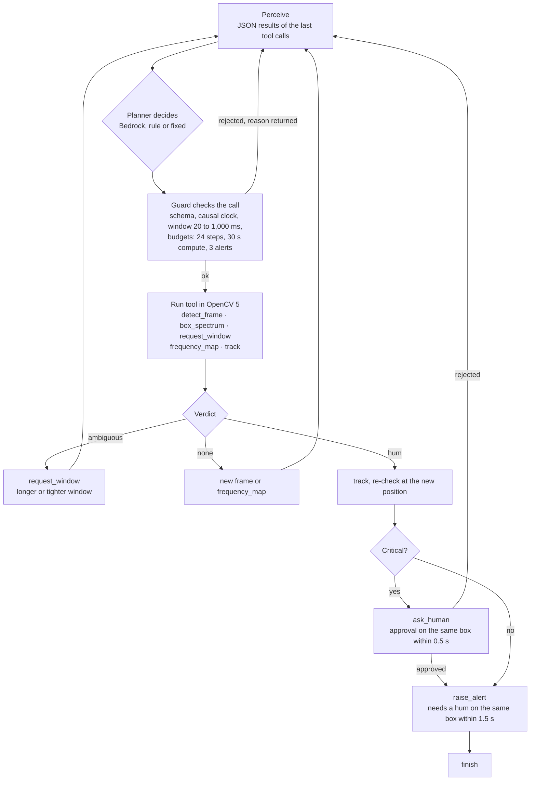

The next call follows the visual verdict. Over 24 scenarios, after **ambiguous** the Bedrock planner asked for a new window 28 of 51 times; after **hum** it tracked (8) or asked a human (2). Source: [`results/agent/eval_v4/results.json`](results/agent/eval_v4/results.json), `summary.bedrock.next_tool_after_verdict`. The drawn version is [`docs/agent_workflow.svg`](docs/agent_workflow.svg). Replaying each step with the same history, a blinded spectrum changed Bedrock's next action at 39 of 130 vision steps and a shuffled one at 53 of 130; a repeat with the real result matched the logged action 125 of 130 times ([`vision_ablation.json`](results/agent/eval_v4/vision_ablation.json)).

### One real trace: `bedrock_late_142`

FRED test sequence 142: a DJI Tello EDU enters at 26.0 s and the DNN proposes nothing in three looks. The agent chooses the whole-frame frequency map, finds a 545 Hz spot and confirms a drone the detector missed. Source: [`results/agent/eval_v4/traces/bedrock_late_142.jsonl`](results/agent/eval_v4/traces/bedrock_late_142.jsonl).

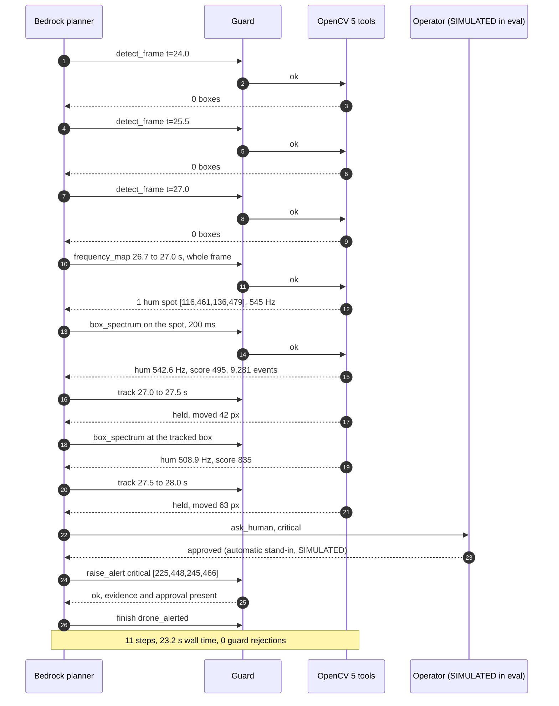

<details>
<summary><b>The agent on the live page</b></summary>

<p align="center">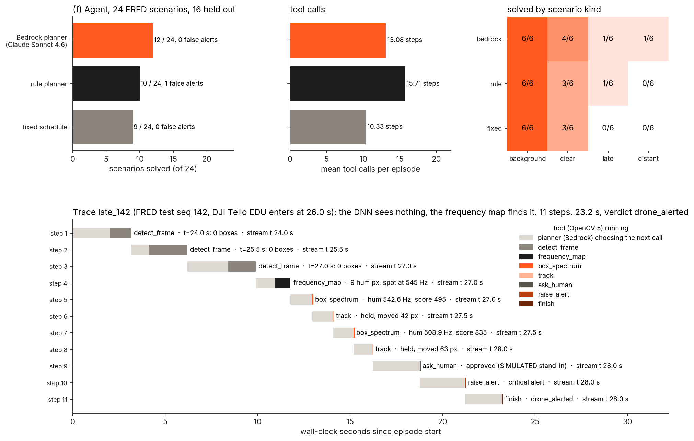</p>

The agent slide replays the real eval_v3 traces. Its **Run agent live** button runs the same agent code on the server: Claude Sonnet 4.6 on Amazon Bedrock (`us.anthropic.claude-sonnet-4-6`, Converse) plans on the clip picked at the top (DJI Mini 2 is FRED sequence 202) against the live OpenCV 5 tools. It stops before a critical alert and waits up to 60 s for the visitor's Approve or Reject. With no answer the run ends unconfirmed, waiting for an operator, and no alert is raised. The page names the planner that ran: after 15 Bedrock runs in a UTC day, or on a Bedrock error, the rule planner takes over. At the end it shows the clip's expected frequency and the IoU of the agent's box with the FRED ground-truth box. One live run per visitor and at most three at once. In the replay, Approve and Reject record the viewer's decision on the server and trigger nothing else. Two earlier development runs on the same scenarios are in `results/agent/dev_runs/`.

</details>

## Results

All on FRED, a public dataset of real event + RGB drone recordings (Apache-2.0). Thresholds were chosen on train sequences and reported on the 47 test sequences. Every number, with its denominator, is in [`docs/REPORT.md`](docs/REPORT.md).

| Result | Number | Source |
|---|---|---|
| False alarms per minute, RGB detector vs RGB + hum (151,768 frames, 84.3 min) | **412.7 → 308.4 (−25%)**, recall 0.544 → 0.544, precision 0.670 → 0.731, mAP@0.5 0.505 → 0.516 | [`results_test.json`](results/detector/results_test.json) |
| False detections removed / true detections lost | **8,790 of 34,796** / 26 of 70,794 | same |
| High-precision setting, RGB + hum score ≥ 98 | precision **0.815** at recall 0.146, 51.2 false alarms per minute | same |
| Hum score AUC, drone box vs random patch / vs busiest non-drone patch (100 ms) | **0.917** / 0.758 (26,911 drone boxes) | [`summary.json`](results/engine/summary.json) |
| Blade-pass medians vs PropPulse published medians | DJI Mini 2: **320 Hz** (median of 1,951 test boxes scoring at least 7.86); PropPulse 316 Hz. The 316 Hz demo clip is FRED 202. Tello EDU 564 vs 539 Hz, Mini 3 245 vs 223 Hz | [`per_model_youden.json`](results/engine/per_model_youden.json) |
| COOL vs pip OpenCV 5, OpenCV ops the engine uses on a 1280×720 test image, same Graviton4 host, 4 threads | GaussianBlur **1.89x**, dft **1.54x**, connectedComponentsWithStats **1.17x** faster under COOL; DNN forward 0.92x | [COOL on Graviton4](#cool-on-graviton4) |
| Full confirm step on 180 FRED windows, Graviton4 + COOL vs x86 c7i.xlarge | Per 1,000 windows, 0.00297 USD against 0.00423 to 0.00441 USD on x86, **30 to 33% less** (EC2 on-demand); **17 to 22% faster** per window. Frequency map **1.26x** faster than pip on the same host at 100 ms of events and **1.45x** at 500 ms; outputs identical | [`E2E.md`](bench/results/E2E.md) |
| Graviton4 vs x86 (pip OpenCV 5, 4 vCPUs, 4 threads) | faster on 5 of 6 ops, up to **2.07x** (cvtColor) | [`pip-graviton4-c8g.xlarge.json`](bench/results/pip-graviton4-c8g.xlarge.json), [`pip-x86-c7i.xlarge.json`](bench/results/pip-x86-c7i.xlarge.json) |
| Agent, 24 FRED scenarios (16 held out) | Bedrock **12 / 24, 0 false alerts** (rule 10, fixed 9). Vision blinded: 6 / 24. Operator reject, timeout and approve each held in 6 of 6 Bedrock episodes that asked (approval scripted in the evaluation). 21 of 21 fault cases handled (20 injected faults plus a no-fault control) | [`results.json`](results/agent/eval_v4/results.json), [`vision_ablation.json`](results/agent/eval_v4/vision_ablation.json), [`faults`](results/agent/faults/TABLE.md) |

<details>
<summary><b>Detector and full pipeline on FRED test</b></summary>

Every frame of all 47 test sequences, matching at IoU 0.5, each rule chosen on held-out train sequences ([`thresholds_trainval.json`](results/detector/thresholds_trainval.json)). Source: [`results/detector/results_test.json`](results/detector/results_test.json).

| Pipeline | mAP@0.5 | Precision | Recall | False alarms per minute |
|---|---|---|---|---|
| RGB detector only | 0.505 | 0.670 | 0.544 | 412.7 |
| **RGB + hum (train-chosen, score ≥ 3)** | **0.516** | **0.731** | **0.544** | **308.4** |
| RGB + hum + motion | 0.446 | 0.772 | 0.473 | 215.4 |
| RGB + hum, ambiguous threshold (score ≥ 7.9) | 0.413 | 0.779 | 0.426 | 186.2 |
| RGB + hum, clear threshold (score ≥ 98) | 0.141 | 0.815 | 0.146 | 51.2 |
| RGB + motion only | 0.441 | 0.722 | 0.473 | 280.9 |

At IoU 0.3 the train-chosen hum rule cuts false alarms per minute from 245.2 to 142.0 (−42%). Event-only baseline ([`results_event_only.json`](results/detector/results_event_only.json)): AP 0.066, so the hum works as a confirmation on detector proposals, not as a detector.

</details>

<details>
<summary><b>Hum per drone model vs an independent estimate</b></summary>

<p align="center">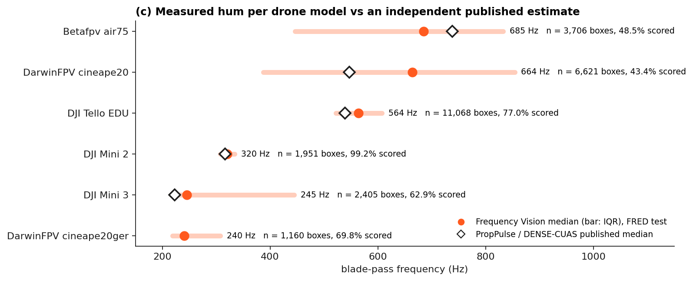</p>

| Drone | Test boxes | Boxes ≥ 7.86 | Frequency Vision median (IQR) | PropPulse median |
|---|---|---|---|---|
| DJI Mini 2 | 1,951 | 99.2% | 320 Hz (308 to 334) | 316 Hz |
| DJI Tello EDU | 11,068 | 77.0% | 564 Hz (522 to 608) | 539 Hz |
| DJI Mini 3 | 2,405 | 62.9% | 245 Hz (217 to 445) | 223 Hz |
| BetaFPV Air75 | 3,706 | 48.5% | 685 Hz (446 to 833) | 738 Hz |
| DarwinFPV Cineape20 | 6,621 | 43.4% | 664 Hz (387 to 854) | 547 Hz |
| DarwinFPV Cineape20 (GER) | 1,160 | 69.8% | 240.5 Hz (219 to 308) | not reported |

Four of the five models PropPulse / DENSE-CUAS reports land within 10% of its medians on the same dataset. The fast DarwinFPV Cineape20 has weak, scattered peaks, and its wide spread shows it. Source: [`per_model_youden.json`](results/engine/per_model_youden.json).

</details>

<details>
<summary><b>Known-frequency check and hum-score ROC</b></summary>

<p align="center">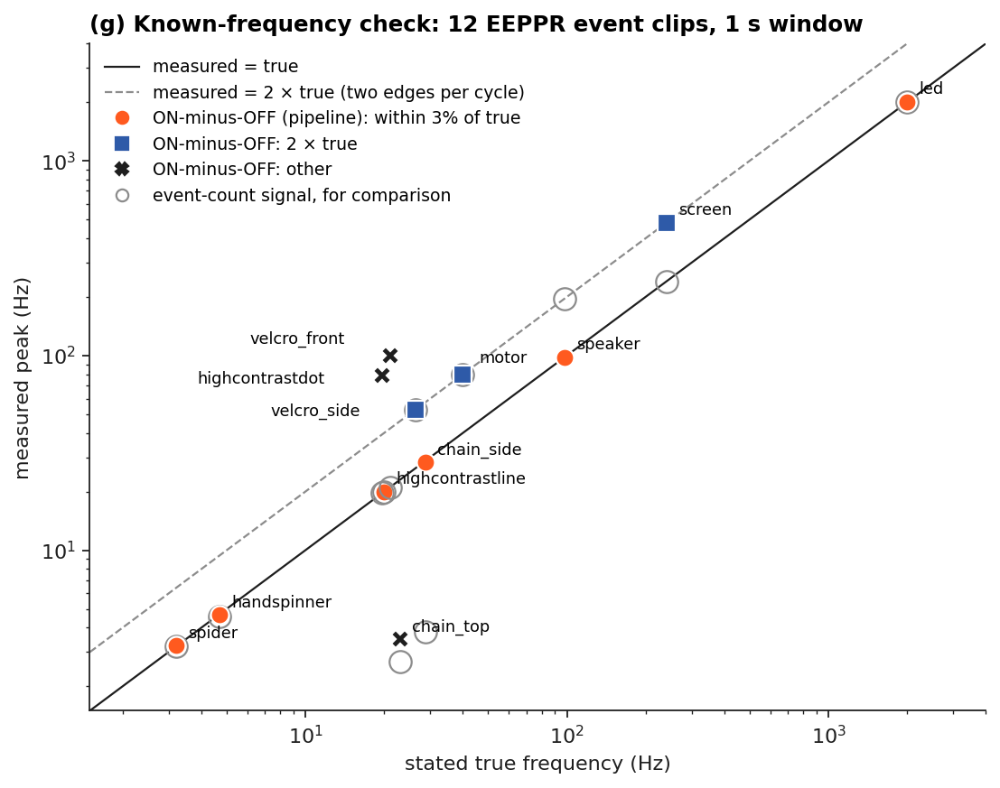</p>

On 12 EEPPR clips with stated frequencies (1 s window), the pipeline signal (ON minus OFF events per 0.1 ms bin) lands within 2% of the stated frequency on 6 (LED 2,000 Hz, speaker 98 Hz, chain side 28.7 Hz, line 20 Hz, hand spinner 4.7 Hz, spider 3.2 Hz) and at exactly twice it on 3 (screen, motor, velcro side), where each cycle makes two edges. Velcro front reads 100.01 Hz (4.7 times) and dot 78.58 Hz (4.0 times), and chain top is wrong. The plain event-count signal lands within 3% on 7 and at twice the rate on 3. The Prophesee 40 and 50 Hz monitoring clip reads 99.95 Hz (ON minus OFF) and 79.95 Hz (count). Source: [`known_freq.json`](results/engine/known_freq.json).

| Clip | Stated (Hz) | ON-minus-OFF, the pipeline signal (Hz) | Event count (Hz) |
|---|---|---|---|
| led | 2,000 | 2,000.0 | 1,999.99 |
| screen | 240 | 479.97 | 239.99 |
| speaker | 98 | 97.82 | 195.66 |
| motor | 40 | 79.95 | 79.95 |
| chain_side | 28.7 | 28.23 | 3.82 |
| velcro_side | 26.3 | 52.62 | 52.62 |
| chain_top | 23 | 3.48 | 2.67 |
| velcro_front | 21.1 | 100.01 | 21.1 |
| highcontrastline | 20 | 19.92 | 19.92 |
| highcontrastdot | 19.6 | 78.58 | 19.63 |
| handspinner | 4.7 | 4.65 | 4.58 |
| spider | 3.2 | 3.23 | 3.21 |

<p align="center">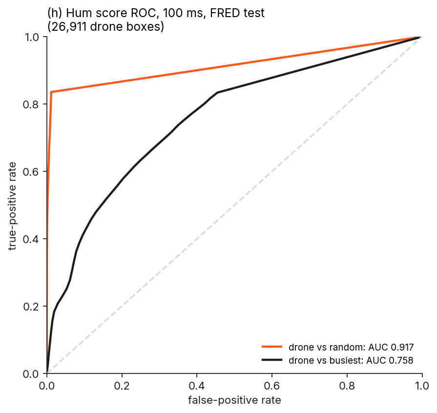</p>

</details>

<details>
<summary><b>Scope, failure cases and responsible use</b></summary>

**What it is built for.** Frequency Vision confirms detector proposals. The hum is a confirmation signal, not a finder: event-only detection on FRED reaches AP 0.066, so the RGB detector proposes and the agent gathers more windows on ambiguous boxes. The tested setting is FRED: one Prophesee EVK4 sensor in daytime outdoor scenes. Distant drones (box ≤ 30 px) give too few events for a peak, so the agent holds them as unconfirmed (Bedrock confirms 1 of 6 distant scenarios, the rule planner and the fixed schedule 0). Fast FPV drones such as the Cineape20 give weak, scattered peaks. Mains-driven lights flicker at multiples of 100 Hz; the notch and the whole-frame frequency map handle them, since one frequency filling the whole scene means flicker. The agent evaluation covers 24 fixed scenarios with a scripted operator (approve, reject, no answer); on the live page a person presses Approve or Reject.

**Responsible use.**
- Detection and alerting only. It never intercepts, jams or follows a person.
- A critical alert needs a human's approval, enforced by the guard in code, not by the prompt.
- The confirm step uses event timing inside a box, not appearance. The planner receives JSON numbers (boxes, Hz, scores), never images.
- All data shown is the public FRED dataset. Simulated approval is labelled SIMULATED in every trace.
- Thresholds are set on train data with an explicit false-alarm target, because a false drone alarm can halt a runway.
- The endpoint has no SSH, HTTPS only, a least-privilege IAM role, guard-capped agent budgets, and an approval endpoint with input validation and a size cap.

Failure cases with numbers: [`docs/REPORT.md`](docs/REPORT.md) §9.

</details>

## COOL on Graviton4

Full COOL write-up for judges, with the per-stage call map and reproduce steps: [`docs/COOL.md`](docs/COOL.md).

COOL (Cloud Optimized OpenCV for AWS Graviton4, AWS Marketplace product code `aajkmdd4qo3r7yhqg61a7aah9`, AMI `ami-033e481a24f94c8cb`) runs the whole live workload. The live host `c8g.medium` (`i-0d59ee3505c397229`) serves `cv2` from `/opt/cool`, read from `/version` and the EC2 API ([`cool-proof-live-c8g.medium.json`](bench/results/cool-proof-live-c8g.medium.json)). Proof captured through SSM on the benchmark instance ([`cool-proof-c8g.xlarge.json`](bench/results/cool-proof-c8g.xlarge.json)):

```
opencv          5.1.0-dev
cv2_file        /opt/cool/python_3.12/site-packages/cv2/__init__.py
machine         aarch64
instance_type   c8g.xlarge
ami_id          ami-033e481a24f94c8cb
product_codes   aajkmdd4qo3r7yhqg61a7aah9
baseline        SVE NEON FP16 NEON_DOTPROD NEON_FP16 NEON_BF16
custom_hal      YES (carotene (ver 0.0.1) KleidiCV (ver 0.7.0))
```

The live endpoint reports the same build on every `GET /version`. Check it yourself:

```bash
curl -s https://100-27-6-111.sslip.io/version
curl -s -X POST https://100-27-6-111.sslip.io/api/spectrum \
  -H 'content-type: application/json' \
  -d '{"clip":"clear_mini2_seq202","box":[791,469,917,504],"t":1.767,"window_ms":100}'
```

`/version` reports `"cool": true`, OpenCV `5.1.0-dev` loaded from `/opt/cool`, `aarch64` and the KleidiCV 0.7.0 HAL. On 2026-10-26 the spectrum call returned the Mini 2's peak at 315.9 Hz with a score of 26,655 from 38,845 events, computed in 4.6 ms on the server (the figure above, drawn locally with pip OpenCV on the same 100 ms window, gives 26,656).

<p align="center">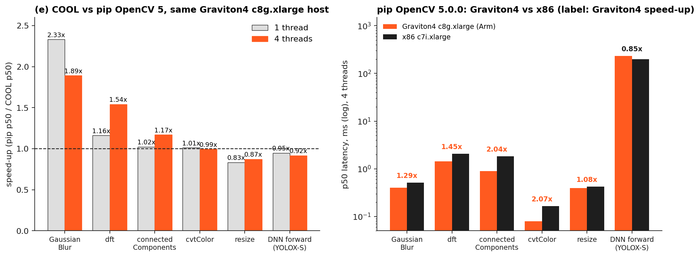</p>

**COOL vs pip OpenCV 5.0.0, same `c8g.xlarge` host**, p50 ms, same inputs, run back to back ([`cool-graviton4-c8g.xlarge.json`](bench/results/cool-graviton4-c8g.xlarge.json), [`pip-graviton4-c8g.xlarge-samehost.json`](bench/results/pip-graviton4-c8g.xlarge-samehost.json)):

| Op | pip, 4 threads | COOL, 4 threads | COOL speed, 4 threads | COOL speed, 1 thread |
|---|---|---|---|---|
| GaussianBlur | 0.388 | 0.205 | **1.89x** | **2.33x** |
| dft 512×512 | 1.450 | 0.940 | **1.54x** | **1.16x** |
| connectedComponentsWithStats | 0.895 | 0.765 | **1.17x** | 1.02x |
| cvtColor | 0.080 | 0.081 | 0.99x | 1.01x |
| resize | 0.393 | 0.450 | 0.87x | 0.83x |
| DNN forward (YOLOX-S) | 234.1 | 254.8 | 0.92x | 0.95x |

COOL speeds up the event engine's own operations. Resize and the DNN forward pass are slower on this COOL build. Output differences, COOL vs pip ([`diff-cool-vs-pip-c8g.xlarge.json`](bench/results/diff-cool-vs-pip-c8g.xlarge.json)): at most 1 grey level for resize, cvtColor and blur; `dft` maximum difference 9e-8 of the output range; DNN 3.3e-5; `connectedComponentsWithStats` labels differ in 0.19% of elements, which is label numbering.

**End to end** ([`E2E.md`](bench/results/E2E.md), round 2): 180 real FRED windows from 6 clips (detector, a hum check on each of its 147 boxes, and the full-sensor frequency map), each runtime at its fastest correct setting (classic DNN engine loaded from the model path, 4 threads). Graviton4 + COOL takes p50 60.4 ms per window against 72.6 to 77.1 ms on x86 c7i.xlarge: 17 to 22% faster and 30 to 33% cheaper per window. The classic DNN engine cut the detector under COOL from 103.5 to 55.0 ms. On real FRED events the frequency map runs 1.26x faster under COOL than pip on the same host at 100 ms windows (7.15 vs 9.05 ms) and 1.45x at 500 ms (149.9 vs 217.9 ms), 2.9x faster than x86 (433.3 ms). pip on the same Graviton4 is 5% faster end to end (57.6 vs 60.4 ms). Outputs are identical: the same 147 boxes, 0.0 px and 0.0 score difference, 0 hum verdict flips. COOL ships 5.1.0-dev and the newest public pip wheel is 5.0.0.93, so that is the baseline. Round 1 (7 clips, 210 windows, default engine) stays in `E2E.md` as history.

**Graviton4 vs x86**, pip OpenCV 5.0.0 on both, 4 vCPUs: Graviton4 is faster on 5 of 6 ops, up to 2.07x on cvtColor; x86 wins the DNN forward pass. Full table with cost per call: [REPORT §6](docs/REPORT.md).

## Reproduce

Python 3.12 or 3.13, pinned dependencies, pip OpenCV 5.0.0 locally. The demo clips ship in `app/data` and `app/static/data`, so the app needs no download. The DNN detector model is not in the repo: put it at `build/models/strobe_drone_960x544.onnx` beside the repo folder, or point `HERTZ_DETECTOR_ONNX` at it ([`THIRD_PARTY.md`](THIRD_PARTY.md) shows how to retrain and export it). Without it, the app runs the event-blob fallback.

```bash
pip install -r requirements-dev.txt
pytest -q                      # 70 passed
python tools/int64_repro.py
uvicorn app.main:app --port 8080
python docs/figures/make_figures.py
```

<details>
<summary><b>Engine, detector, agent and AWS commands</b></summary>

Hum engine on FRED (Linux, builds the Prophesee ECF decoder):

```bash
sh hertz/ecf/build.sh
python hertz/fred_claim.py <fred_test_root> <out_test> <seq ids...>
python hertz/fred_claim.py <fred_train_root> <out_train> <seq ids...>
python hertz/fred_claim_report.py <out_test> <out_train> summary.json table.csv
python hertz/known_freq.py <eeppr_dir> <monitoring_40_50hz.hdf5> known_freq.json
```

Detector and full pipeline:

```bash
sh eval/get_fred_eval_data.sh
python eval/run_eval.py --onnx <model.onnx> --trainval_root <dir> --test_root <dir> --out <dir>
python eval/event_only.py --trainval_root <dir> --test_root <dir> --out <dir>
```

Agent (`--planners rule,fixed` runs offline; the Bedrock planner needs Bedrock access in us-east-1):

```bash
pip install -r hertz/agent/requirements.txt
python eval/export_fred_slices.py <fred_test_root> <ecf_dir> <shift_dir> eval/scenarios_v4.json data/fred_slices
python eval/agent_eval.py --planners rule,fixed --out runs/agent
```

AWS: `python deploy/aws.py cool --type c8g.medium` launches or updates the COOL endpoint, and `python deploy/aws.py cool-bench --name strobe-cool-bench` runs the same-host benchmark on its own instance. See [`deploy/README.md`](deploy/README.md) and [`docs/REPORT.md`](docs/REPORT.md) §12. Every figure is drawn by [`docs/figures/make_figures.py`](docs/figures/make_figures.py) from committed result files and the committed FRED event slices in `app/data/`.

</details>

<details>
<summary><b>Repo map</b></summary>

| Path | What |
|---|---|
| `hertz/freq.py` | The hum engine: `box_spectrum`, `frequency_map`, activity mask, score |
| `hertz/detect.py` | OpenCV 5 DNN detector (`ENGINE_NEW`, letterbox, NMS) |
| `hertz/agent/` | Tools, guard, planners (Bedrock, rule, fixed), runner, MCP server, fault injection |
| `hertz/ecf/` | Prophesee ECF decoder build (Apache-2.0) for FRED events |
| `hertz/fred_claim*.py`, `hertz/known_freq.py` | Engine evaluation on FRED and on known-frequency clips |
| `app/` | FastAPI app, live page (`app/static`), demo event slices (`app/data`) |
| `eval/` | Detector training and export, full-pipeline eval, event-only baseline, agent eval, frozen scenarios |
| `bench/` | Benchmark runner, comparisons, price lookup; results in `bench/results/` |
| `deploy/` | AWS launch and update (`aws.py`), instance provisioning |
| `results/` | Every reported number: `detector/`, `engine/`, `agent/eval_v4/` (24 scenarios, vision ablation, human control) with traces; `agent/faults/` (21 cases: 20 injected faults plus a no-fault control); `agent/eval_v3/` and `agent/dev_runs/` hold earlier development runs |
| `tests/` | 70 tests: engine, endpoint, guard, injected planner, tool and operator faults |
| `tools/` | `int64_repro.py`, web and agent-slice export |
| `docs/` | Report, Devpost text, diagrams, figures and their script |

The code package is `hertz`. AWS resource names keep the project's early working name `strobe` (see [deploy README](deploy/README.md)).

</details>

<details>
<summary><b>Prior work and how this differs</b></summary>

- **PropPulse / DENSE-CUAS** (github.com/cweekiat/dense-cuas): detects the blade-pass rhythm in FRED events, event-only, with RGB as a rival. Frequency Vision uses RGB to propose and events to confirm inside the box, adds an agent that chooses the next look, and runs in OpenCV 5 on Arm. Its per-model medians are our independent check.
- **DDHF** (arXiv:2603.08386): event-only drone detection on a GPU; reports failures on edge-on rotors and on wheel spokes and fences. Frequency Vision runs on CPU and pairs the event check with an RGB proposal and a whole-frame frequency map that separates a rotor from scene-wide periodic texture.
- **Stewart et al., event-based virtual fence** (doi:10.1145/3546790.3546800): detects drones crossing a virtual boundary from the propeller signature. Frequency Vision confirms detector proposals box by box and lets an agent choose the next measurement.

We found no prior system that combines an RGB proposer, an event-frequency confirmation inside the box, and an agent that chooses the next measurement.

</details>

## Licences

Copyright 2026 Mohamad Yazan Sadoun. Apache-2.0, see [`LICENSE`](LICENSE) and [`NOTICE`](NOTICE). Third-party code, models and data are listed in [`THIRD_PARTY.md`](THIRD_PARTY.md). FRED is used under Apache-2.0 per its Hugging Face card. EEPPR is GPL-3.0 and is downloaded at run time, never committed. The Prophesee sample recording is CC0. The detector weights were trained with Ultralytics (AGPL-3.0) in a separate training environment and are not distributed; the runtime uses only OpenCV.

---

Technical report: [`docs/REPORT.md`](docs/REPORT.md) · Architecture: [`docs/architecture.svg`](docs/architecture.svg) · Agent loop: [`docs/agent_workflow.svg`](docs/agent_workflow.svg) · Devpost text: [`docs/DEVPOST.md`](docs/DEVPOST.md)
