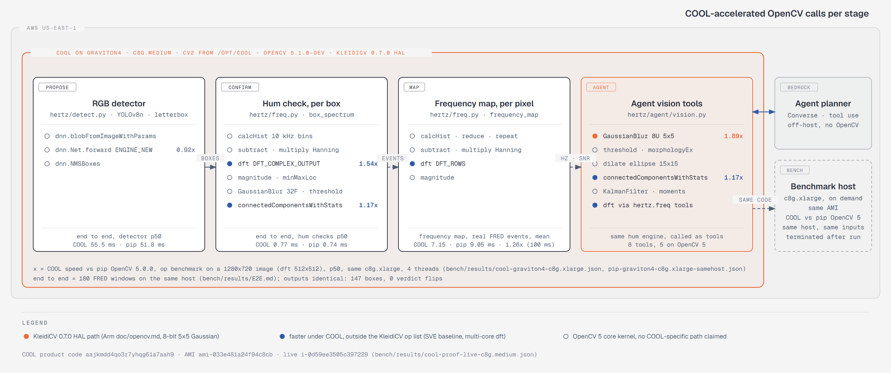

# Frequency Vision on COOL

COOL runs the whole live workload of Frequency Vision on one AWS Graviton4 host: the web page, the event hum engine, the drone detector and the agent's vision tools. On the same Graviton4 host, COOL runs the engine's FFT 1.54x faster and its Gaussian blur 1.89x faster than pip OpenCV 5, and the two builds give identical detections and hum verdicts.

<p align="center"></p>

Diagram source: [`cool_architecture.svg`](cool_architecture.svg).

## 1. Why event-camera signal processing suits COOL

A drone's propellers make its events flicker at a fixed rate. Frequency Vision finds that rate with ordinary OpenCV signal processing over the events: bin them in time, window them, run a DFT and read the peak. The work is many small, regular array operations: one spectrum per detector box, and one spectrum per active pixel for the full-sensor frequency map (`cv.dft` with `DFT_ROWS` over thousands of pixel time series at once). These are the vectorised, multi-core loops that an Arm-tuned build speeds up.

COOL is OpenCV 5.1.0-dev built for Graviton4 with an SVE baseline and the Arm KleidiCV 0.7.0 HAL (proof in §3). The table maps every OpenCV call on the hot path to that build. The "KleidiCV 0.7.0 HAL" column comes from the KleidiCV OpenCV HAL list at its primary source, [`doc/opencv.md` at tag 0.7.0](https://gitlab.arm.com/kleidi/kleidicv/-/blob/0.7.0/doc/opencv.md) (read 2026-10-26). The speed column is the same-host benchmark in §4.

| OpenCV call | Where | KleidiCV 0.7.0 HAL | COOL vs pip, 4 threads |
|---|---|---|---|
| `GaussianBlur`, 8-bit, 5x5 | agent event-blob tool ([`vision.py`](../hertz/agent/vision.py)); benchmark op | Yes: `CV_8U` input, 5x5 is a listed kernel size | **1.89x** (2.33x on 1 thread) |
| `dft` | hum check and frequency map ([`freq.py`](../hertz/freq.py)) | Not on the list | **1.54x** (1.16x on 1 thread) |
| `connectedComponentsWithStats` | hum activity mask, agent tools | Not on the list | **1.17x** (1.02x on 1 thread) |
| `cvtColor` BGR to gray | benchmark op | Not on the list (KleidiCV converts RGB/BGR/YUV, no gray target) | 0.99x |
| `resize`, 8-bit 3-channel, 1280x720 to 640x640 | benchmark op; detector letterbox inside `blobFromImageWithParams` | Only 8-bit 1-channel or 32-bit float 1-channel at fixed 0.5x, 2x, 4x, 8x ratios | 0.87x |
| `dnn` forward | detector ([`detect.py`](../hertz/detect.py)) | Not in KleidiCV's scope | 0.92x |
| `subtract`, `multiply` | spectrum windowing, 32-bit float | Listed for 8- and 16-bit integers only | not benchmarked |
| `calcHist`, `magnitude`, `minMaxLoc`, `threshold`, `reduce`, `repeat`, `copyMakeBorder` | spectrum and mask | Not on the list | not benchmarked |

The engine's two largest gains, `dft` and connected components, come from the COOL build outside the KleidiCV op list. The benchmark files show how for `dft`: at 4 threads pip OpenCV keeps the 512x512 DFT on one core (CPU 25% of 4 vCPUs), while COOL spreads it across cores (CPU 58%) and finishes in 0.940 ms instead of 1.450 ms. The SVE baseline is the other build difference (§3). COOL's source is not public, so this split between SVE code and threading is read from the measured CPU use and the build line, not from COOL's code.

## 2. Where COOL sits in the live architecture

One Graviton4 instance, `c8g.medium`, launched from the COOL Marketplace AMI, runs everything that touches pixels or events. The app runs on COOL's own Python 3.12 build (`/usr/local/bin/coolpy`, OpenCV from `/opt/cool`), so every `import cv2` in the process is COOL ([deploy README](../deploy/README.md)).

| Stage | Code | Runs on |
|---|---|---|
| Web page and API (FastAPI behind Caddy, HTTPS) | [`app/api.py`](../app/api.py) | COOL host |
| Hum engine: spectrum per box, frequency map per pixel | [`hertz/freq.py`](../hertz/freq.py) | COOL host |
| Drone detector, YOLOv8n ONNX through the OpenCV 5 DNN engine | [`hertz/detect.py`](../hertz/detect.py) | COOL host |
| Agent vision tools | [`hertz/agent/vision.py`](../hertz/agent/vision.py), [`hertz/agent/tools.py`](../hertz/agent/tools.py) | COOL host |
| Agent planner (Amazon Bedrock, Converse with tool use) | [`hertz/agent/planners.py`](../hertz/agent/planners.py) | managed service; calls the tools on the COOL host |
| Benchmarks, COOL and pip on one host | [`bench/bench.py`](../bench/bench.py), [`bench/e2e.py`](../bench/e2e.py) | separate on-demand `c8g.xlarge` from the same AMI, terminated after each run |

There is no x86 component on the live path. The `c7i.xlarge` x86 host appears only as a benchmark baseline ([REPORT §6](REPORT.md)).

## 3. Proof that COOL runs the workload

| Field | Live host | Benchmark host |
|---|---|---|
| Source | [`cool-proof-live-c8g.medium.json`](../bench/results/cool-proof-live-c8g.medium.json), from `GET /version` and the EC2 API | [`cool-proof-c8g.xlarge.json`](../bench/results/cool-proof-c8g.xlarge.json), via SSM on the instance |
| Marketplace listing | [Cloud Optimized OpenCV For AWS Graviton4](https://aws.amazon.com/marketplace/pp/prodview-fdvbfiewzuehs) | same |
| Product code | `aajkmdd4qo3r7yhqg61a7aah9` | `aajkmdd4qo3r7yhqg61a7aah9` |
| AMI | `ami-033e481a24f94c8cb` | `ami-033e481a24f94c8cb` |
| Instance | `c8g.medium`, `i-0d59ee3505c397229` | `c8g.xlarge`, `i-0ac2fc8911b040475` |
| Machine | `aarch64` | `aarch64` |
| OpenCV | `5.1.0-dev` | `5.1.0-dev` |
| `cv2.__file__` | `/opt/cool/python_3.12/site-packages/cv2/__init__.py` | `/opt/cool/python_3.12/site-packages/cv2/__init__.py` |
| Custom HAL | `YES (carotene (ver 0.0.1) KleidiCV (ver 0.7.0))` | `YES (carotene (ver 0.0.1) KleidiCV (ver 0.7.0))` |
| Baseline | | `SVE NEON FP16 NEON_DOTPROD NEON_FP16 NEON_BF16` |

The pip baseline on the same host reports `Baseline: NEON FP16`, `Custom HAL: YES (carotene (ver 0.0.1))` and `cv2` from `/srv/strobe/venv` ([`pip-graviton4-c8g.xlarge-samehost.json`](../bench/results/pip-graviton4-c8g.xlarge-samehost.json), `meta.build`).

Check the live host yourself:

```bash
curl -s https://100-27-6-111.sslip.io/version
```

## 4. Measured results

### OpenCV operations, same Graviton4 host

COOL and pip `opencv-contrib-python-headless` 5.0.0, run back to back on `c8g.xlarge` `i-0ac2fc8911b040475`, 1280x720 test image, p50 ms. Files: [`cool-graviton4-c8g.xlarge.json`](../bench/results/cool-graviton4-c8g.xlarge.json), [`pip-graviton4-c8g.xlarge-samehost.json`](../bench/results/pip-graviton4-c8g.xlarge-samehost.json).

| Op | pip, 4 threads | COOL, 4 threads | COOL speed, 4 threads | COOL speed, 1 thread | COOL USD per 1M calls, 4 threads |
|---|---|---|---|---|---|
| GaussianBlur | 0.388 | 0.205 | **1.89x** | **2.33x** | 0.009 (pip 0.017) |
| dft 512x512 | 1.450 | 0.940 | **1.54x** | **1.16x** | 0.042 (pip 0.064) |
| connectedComponentsWithStats | 0.895 | 0.765 | **1.17x** | 1.02x | 0.034 (pip 0.040) |
| cvtColor | 0.080 | 0.081 | 0.99x | 1.01x | 0.004 (pip 0.004) |
| resize | 0.393 | 0.450 | 0.87x | 0.83x | 0.020 (pip 0.017) |
| DNN forward | 234.1 | 254.8 | 0.92x | 0.95x | 11.299 (pip 10.376) |

Cost is the `c8g.xlarge` on-demand price, 0.15952 USD per hour (`meta.price_usd_hour`), times the measured time per call. The COOL Marketplace software fee is not included.

Output agreement, COOL vs pip ([`diff-cool-vs-pip-c8g.xlarge.json`](../bench/results/diff-cool-vs-pip-c8g.xlarge.json)): resize, cvtColor and GaussianBlur differ by at most 1 grey level; `dft` by at most 8.7e-8 of the output range; DNN by at most 3.3e-5.

### End to end, the confirm step on real FRED data

210 windows from 7 FRED clips, 3 passes each after 10 warm-up windows, same `c8g.xlarge`, 4 threads, alternating COOL, pip, COOL, pip ([`E2E.md`](../bench/results/E2E.md)).

| Runtime | p50 ms per window | windows/s | detector p50 ms | hum checks p50 ms | frequency map p50 ms |
|---|---|---|---|---|---|
| COOL, run 1 | 106.2 | 8.83 | 103.3 | 0.83 | 1.85 |
| COOL, run 2 | 106.5 | 8.80 | 103.7 | 0.82 | 1.86 |
| pip, run 1 | 98.9 | 9.32 | 95.8 | 0.80 | 2.08 |
| pip, run 2 | 98.9 | 9.31 | 95.9 | 0.78 | 2.02 |

COOL computes the full-sensor frequency map 1.13x faster (1.85 vs 2.08 ms, run 1). The detector's DNN forward pass sets the window total. Both builds return the same 169 boxes, equal detector scores, hum peaks within 0.0001 Hz and zero verdict changes ([`e2e-diff-cool-vs-pip-c8g.xlarge.json`](../bench/results/e2e-diff-cool-vs-pip-c8g.xlarge.json)). COOL ships OpenCV 5.1.0-dev, and the baseline is the newest OpenCV 5 wheel on PyPI, 5.0.0.93.

## 5. Reproduce

Needs Python 3.10+, `pip install boto3==1.43.118`, an AWS CLI profile (default `opencv26`, override with `AWS_PROFILE`), and a subscription to the [COOL Graviton4 listing](https://aws.amazon.com/marketplace/pp/prodview-fdvbfiewzuehs). Commands from [`deploy/README.md`](../deploy/README.md) and [`deploy/aws.py`](../deploy/aws.py).

Deploy the live endpoint on COOL (one command; re-run to redeploy):

```bash
python deploy/aws.py cool-ami
python deploy/aws.py cool --type c8g.medium
curl https://<cool-host>/version
```

`cool` launches the newest AMI with product code `aajkmdd4qo3r7yhqg61a7aah9`, installs the app's non-OpenCV dependencies into `/opt/cool/venvs/python_3.12`, and serves the app from that interpreter. `/version` then shows `"cool": true`, a `cv2_file` under `/opt/cool` and the KleidiCV HAL line.

Same-host benchmark, COOL vs pip OpenCV 5 (use a separate instance name so the live endpoint keeps running):

```bash
python deploy/aws.py cool --name strobe-cool-bench --type c8g.xlarge
python deploy/aws.py cool-bench --name strobe-cool-bench
python deploy/aws.py e2e
```

`cool-bench` runs [`bench/bench.py`](../bench/bench.py) under COOL and under pip OpenCV 5 on that instance, writes `cool-graviton4-<type>.json`, `pip-graviton4-<type>-samehost.json` and the output diff to `bench/results/`, then terminates it. `e2e` launches its own `c8g.xlarge` from the COOL AMI, runs [`bench/e2e_remote.sh`](../bench/e2e_remote.sh), copies the end-to-end files back and terminates it. Rebuild the table with `python bench/table.py bench/results/*.json`.
