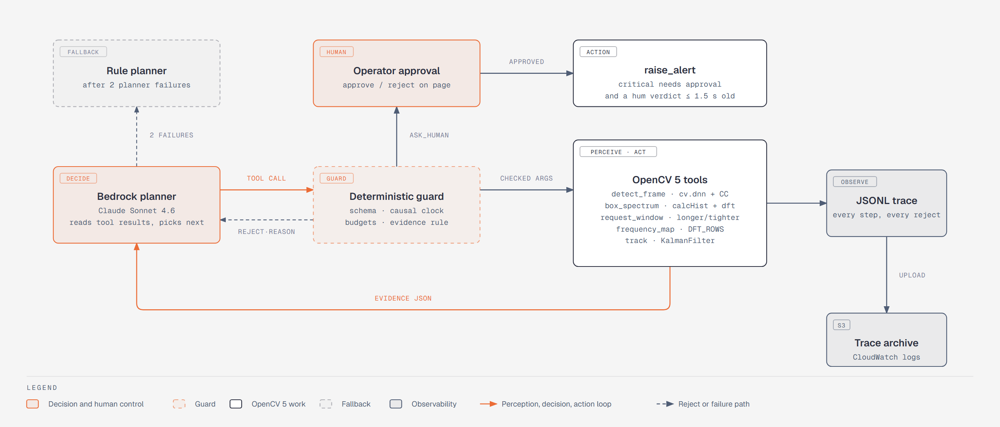

# Strobe: technical report

**Strobe confirms drones by their propeller hum.** An OpenCV 5 DNN detector proposes boxes in normal 30 fps video. Inside each box, the event-camera stream is checked for a blade-pass frequency peak, at hundreds of Hz, that a 30 fps camera cannot see. An agent decides what to look at next: a longer or tighter event window, a whole-frame frequency map, a track, an alert, or a question to a human. Everything runs on AWS Graviton4 with COOL, the cloud-optimized OpenCV 5 build.

A bird and a drone can look the same at 30 fps. Only one of them hums at 320 Hz (DJI Mini 2, measured on FRED).

- Live endpoint: https://100-27-6-111.sslip.io (no login), served by COOL on Graviton4
- Architecture: `docs/architecture.svg` · Agent loop: `docs/agent_workflow.svg`

Headline results, all on the real FRED dataset (event + RGB drone recordings, Apache-2.0):

| Result | Number | Denominator | Source |
|---|---|---|---|
| **The hum check removes a quarter of the detector's false alarms at the same recall** | false alarms per minute **412.7 → 308.4** (−25%); recall 0.544 → 0.544; precision 0.670 → 0.731 | full FRED test split: 47 sequences, 151,768 frames, 84.3 min; 8,790 of 34,796 false detections removed, 26 of 70,794 true ones lost | `results/detector/results_test.json` |
| **Hum frequencies match an outside source** | DJI Mini 2 **320 Hz** vs 316 Hz; DJI Tello **564 Hz** vs 539 Hz; DJI Mini 3 **245 Hz** vs 223 Hz (PropPulse/DENSE-CUAS, same dataset) | 1,951 / 11,068 / 2,405 test boxes | `results/engine/per_model_youden.json` |
| Hum score, drone box vs random background (AUC) | **0.917** | 26,911 drone boxes vs 26,909 background patches, 47 test sequences, 100 ms windows | `results/engine/summary.json` |
| Hum score, drone box vs busiest non-drone patch (AUC) | **0.758** | 26,911 vs 26,909 | same |
| COOL vs pip OpenCV 5, same Graviton4 host, 4 threads | GaussianBlur **1.89x**, dft **1.54x**, connectedComponentsWithStats **1.17x** faster | c8g.xlarge, 6 ops | `bench/results/cool-graviton4-c8g.xlarge.json` vs `pip-graviton4-c8g.xlarge-samehost.json` |
| Agent (Bedrock planner), clean run | **4 of 8** scenarios, **0** false alerts, 30% fewer tool calls than the rule planner at the same score | 8 FRED test scenarios fixed before any run | `results/agent/eval_v3/results.json` |
| Agent finds what the detector missed | the whole-frame frequency map found a **545 Hz** DJI Tello the DNN did not propose | FRED test sequence 142 | `results/agent/eval_v3/traces/bedrock_late_142.jsonl` |

## 1. Problem

Small drones near airports, prisons and stadiums are a daily safety problem. The FAA receives "more than 100" reports of drones near airports each month (FAA UAS sightings page, https://www.faa.gov/uas/resources/public_records/uas_sightings_report). In December 2018 drone sightings closed Gatwick's runway for about 33 hours, cancelling about 1,000 flights and affecting about 140,000 passengers (Wikipedia, "Gatwick Airport drone incident"). <!-- src: _runs/2026-10-26_build/L5_research/REPORT.md; Gatwick primaries not opened -->

A camera-based guard has to answer one question fast: is that dot a drone or a bird, a bag, a leaf? At 30 fps a far drone is a few pixels, and its spinning propellers are invisible because the blade-pass rate (hundreds of Hz) is far above the 15 Hz the camera can represent. An event camera reports each pixel's brightness change with microsecond timing, so the propeller's rhythm is directly in the data. Strobe uses that rhythm as a physical signature that a bird does not have.

## 2. Users

- **Airport, prison and venue security operators** who already run cameras and need fewer false drone alarms, each of which can stop operations.
- **Counter-drone integrators** who want a cheap second opinion on detector boxes that runs on commodity Arm CPUs, not a GPU.
- **Researchers** using FRED who want an OpenCV-native event pipeline they can read and change.

Strobe does not intercept, jam or take any action against a drone. It confirms and alerts, and a critical alert needs a human's approval.

## 3. Architecture


`docs/architecture.svg`. Flow:

1. **Data.** FRED sequences: synchronized RGB frames (30 fps) and events (1280×720, Prophesee ECF format, decoded by the Apache-2.0 Prophesee codec in `strobe/ecf/`).
2. **Propose.** `strobe/detect.py`: a YOLOv8n drone detector fine-tuned on FRED train RGB frames for 10 epochs (validation mAP@0.5 0.577 on held-out train sequences, `results/detector/train_results.csv`), exported to ONNX at 960×544 and run by the OpenCV 5 DNN engine (`cv.dnn.ENGINE_NEW`) with letterbox preprocessing and `cv.dnn.NMSBoxes`. The ONNX output in OpenCV 5.0.0 matches PyTorch to 4.6e-4 on box coordinates and 7.5e-7 on scores over 3 test inputs (`results/detector/check_strobe_drone_yolov8n_960x544.json`).
3. **Confirm.** `strobe/freq.py`: inside each box, events become a 10 kHz ON-minus-OFF time series (`cv.calcHist`), which is windowed and transformed (`cv.createHanningWindow`, `cv.dft`); the peak in 150 to 1,000 Hz is scored against its local spectral floor.
4. **Decide and act.** `strobe/agent/`: a Bedrock planner (Claude Sonnet 4.6, model id `us.anthropic.claude-sonnet-4-6`, set in `strobe/agent/planners.py`) calls eight tools, five of which run OpenCV 5, through a deterministic guard; the same tools are exposed as an MCP server (`strobe/agent/mcp_server.py`, `mcp==1.26.0`).
5. **Serve on COOL.** The always-on endpoint is a Graviton4 `c8g.medium` (instance `strobe-cool`) launched from the COOL Graviton4 AMI. FastAPI + uvicorn run on COOL's OpenCV under `/opt/cool`, behind Caddy (automatic HTTPS). Traces and logs go to S3 and CloudWatch.
6. **Benchmarks only.** A `c8g.xlarge` (COOL vs pip OpenCV 5 on the same host, and pip Graviton4) and a `c7i.xlarge` (x86 baseline) were launched for benchmark runs and terminated afterwards.

## 4. OpenCV 5 implementation

All substantive image and event work is OpenCV 5: COOL's OpenCV 5.1.0-dev build on the live endpoint, and `opencv-contrib-python-headless==5.0.0.93` (pinned in `requirements.txt`) for local runs, tests and evaluation. NumPy is used for indexing and bookkeeping.

| Stage | OpenCV 5 API | Why this API | New in 5.x? |
|---|---|---|---|
| Load the detector | `cv.dnn.readNetFromONNX(np.uint8 buffer, cv.dnn.ENGINE_NEW)` | Graph-based engine with shape inference and fusion; the buffer form avoids the 5.0.0 `bytes` crash | **Yes**: `ENGINE_NEW` graph engine |
| Detector preprocessing | `cv.dnn.Image2BlobParams`, `cv.dnn.blobFromImageWithParams`, `DNN_PMODE_LETTERBOX` | Aspect-preserving letterbox identical to training | No |
| Detector postprocessing | `cv.dnn.NMSBoxes` | Standard non-maximum suppression | No |
| Events to time series | `cv.calcHist` (1-D, on relative int32 µs times) | Fast binning of up to millions of timestamps into a 10 kHz series | No (relative int32 times work around the 5.0.0 int64 binding defect, §4.1) |
| Polarity signal | `cv.subtract`, `cv.mean` | ON-minus-OFF counts follow the blade edge better than raw counts (AUC 0.689 vs 0.643, §8.2) | No |
| Spectrum | `cv.createHanningWindow`, `cv.getOptimalDFTSize`, `cv.copyMakeBorder`, `cv.dft(DFT_COMPLEX_OUTPUT)`, `cv.split`, `cv.magnitude` | Windowed, zero-padded FFT at a fast length | No |
| Peak pick | `cv.minMaxLoc` on the floor-whitened spectrum | Peak location in the drone band | No |
| Per-pixel frequency map | `cv.reduce(REDUCE_AVG)`, `cv.repeat`, `cv.multiply`, `cv.dft(DFT_ROWS)` | One FFT per active pixel in a single call, up to 20,000 pixels | No |
| Activity mask inside a box | `cv.calcHist` (2-D), `cv.GaussianBlur`, `cv.normalize`, `cv.threshold(THRESH_OTSU)`, `cv.connectedComponentsWithStats` | Keeps the propeller blob, drops background edges in the box | No |
| Event blobs (agent's fallback proposer) | `cv.GaussianBlur`, `cv.threshold`, `cv.morphologyEx(MORPH_CLOSE)`, `cv.getStructuringElement`, `cv.connectedComponentsWithStats`, `cv.dilate` | Finds moving event clusters when the DNN proposes nothing | No |
| Tracking | `cv.KalmanFilter`, `cv.moments` | Constant-velocity track on event centroids | No |
| 64-bit integer Mats | `CV_64S` | Microsecond timestamps; this is where we found the int64 defect | **Yes**: 64-bit integer types |
| Web export | `cv.imread`, `cv.imdecode`, `cv.resize(INTER_AREA)`, `cv.cvtColor`, `cv.imencode`, `cv.rectangle`, `cv.putText` | Demo frames and overlays | No |
| Proof of build | `cv.getBuildInformation`, `cv.__file__` | `/version` reports the OpenCV path and HAL lines, so anyone can see COOL (KleidiCV) served the request | KleidiCV HAL is **new in 5.x** |

### 4.1 OpenCV 5.0.0 defect found: int64 arrays silently truncated

The Python binding turns a NumPy `int64` array into 32-bit values by keeping the low 32 bits, with no error. Event timestamps are microseconds since an epoch and do not fit in 32 bits, so any OpenCV call on raw timestamps silently returns wrong numbers. Repro: `python tools/int64_repro.py` (exit code 0 means the defect is present). Output on Windows 11, OpenCV 5.0.0, NumPy 2.4.6, Python 3.13.5:

```
input int64         [1700000000000001, 1700000000000050, 5000000000000]
cv.minMaxLoc        (404635649.0, 658067456.0) expected (5000000000000.0, 1700000000000050.0)
cv.add CV_64S       [809271298, 809271396, 1316134912] expected [3400000000000002, 3400000000000100, 10000000000000]
float64 workaround correct: True | int64 input silently wrong: True
```

Strobe works around it by subtracting each window's start time and passing relative int32 microseconds (`strobe/freq.py`, `_rel_us`). The upstream issue draft is `docs/UPSTREAM_ISSUE_int64.md`.

Other 5.0.0 traps we hit and worked around: `readNetFromONNX(bytes)` crashes (pass a `np.uint8` buffer), DISK + LightGlue fails (ALIKED + LightGlue works), and the default `findHomography` is not USAC (pass `cv.USAC_MAGSAC`).

## 5. AWS deployment

Region us-east-1, every resource tagged `Project=opencv26`. Code: `deploy/README.md`, `deploy/aws.py`, `deploy/provision.sh`.

| Piece | What | Why |
|---|---|---|
| Endpoint | EC2 `c8g.medium` (Graviton4) from the COOL Graviton4 AMI `ami-033e481a24f94c8cb`, instance `strobe-cool`, always on | COOL runs the whole live workload |
| HTTPS | Caddy with an automatic Let's Encrypt certificate on `100-27-6-111.sslip.io` | Real TLS without a domain or load balancer |
| App | uvicorn on 127.0.0.1:8080 under systemd, using COOL's Python 3.12 OpenCV; a one-minute health timer restarts it if `/health` fails | Self-healing |
| Access | Security group opens 80 and 443 only; no SSH; shell through SSM Session Manager | No open admin port |
| Identity | Role `opencv26-strobe-ec2`: SSM, CloudWatch agent, the project S3 bucket, Bedrock InvokeModel | Least privilege, no keys on the box |
| Observability | CloudWatch log group `/opencv26/strobe`, memory and disk metrics, auto-recover alarm | Logs, metrics, automatic instance recovery |
| Storage | Private S3 bucket for release bundles, benchmark outputs and agent traces | One source for deploys and evidence |
| Agent model | Amazon Bedrock Converse API | Managed model, IAM-scoped |
| Benchmarks | `c8g.xlarge` and `c7i.xlarge`, launched per run and terminated | Measurement only |
| Spend guard | AWS Budget `opencv26-alert` with an email alert | Cost control |

`python deploy/aws.py cool` launches or updates the COOL endpoint through SSM Run Command, and `python deploy/aws.py cool-bench` runs the same-host benchmark. On 2026-10-26 the live `/version` returned OpenCV `5.1.0-dev`, `cv2_file` `/opt/cool/python_3.12/site-packages/cv2/__init__.py`, `cool: true`, `aarch64` and `Custom HAL: YES (carotene (ver 0.0.1) KleidiCV (ver 0.7.0))`; the drone-box spectrum call took 1.63 ms on the server. <!-- src: _runs/2026-10-26_build/L7_docs/live_spectrum_check_cool.json -->

## 6. COOL on Graviton

COOL (Cloud-Optimized OpenCV Library) is the OpenCV build sold on AWS Marketplace for Graviton. We use "Cloud Optimized OpenCV For AWS Graviton4" (product code `aajkmdd4qo3r7yhqg61a7aah9`, AMI `ami-033e481a24f94c8cb`). The Graviton2 and Graviton3 COOL AMIs are built on OpenCV 4.12, so they do not meet the OpenCV 5 requirement.

**Proof COOL runs the workload** (`bench/results/cool-proof-c8g.xlarge.json`, captured through SSM on instance `i-0ac2fc8911b040475`): OpenCV `5.1.0-dev` loaded from `/opt/cool/python_3.12/site-packages/cv2/`, baseline `SVE NEON FP16 NEON_DOTPROD NEON_FP16 NEON_BF16`, Custom HAL `carotene (ver 0.0.1) KleidiCV (ver 0.7.0)`, AMI product code `aajkmdd4qo3r7yhqg61a7aah9`. The live endpoint reports the same build on every `/version` call.

**Baseline 1: COOL vs pip OpenCV 5.0.0 on the same `c8g.xlarge` host**, same inputs (OpenCV's `fruits.jpg` at 1280×720), same thread counts, run back to back:

| Op | pip p50 ms, 4 threads | COOL p50 ms, 4 threads | COOL speed, 4 threads | COOL speed, 1 thread |
|---|---|---|---|---|
| GaussianBlur | 0.388 | 0.205 | **1.89x** | **2.33x** |
| dft 512×512 | 1.450 | 0.940 | **1.54x** | **1.16x** |
| connectedComponentsWithStats | 0.895 | 0.765 | **1.17x** | 1.02x |
| cvtColor | 0.080 | 0.081 | 0.99x | 1.01x |
| resize | 0.393 | 0.450 | 0.87x | 0.83x |
| DNN forward (YOLOX-S) | 234.1 | 254.8 | 0.92x | 0.95x |

Source: `bench/results/cool-graviton4-c8g.xlarge.json` and `bench/results/pip-graviton4-c8g.xlarge-samehost.json`. The ops that carry Strobe's confirm step, the blur in the activity mask, the `dft` and the connected components, are the three where COOL wins. Resize and the DNN are slower under COOL on this host. Cost per call scales with time on the same instance, so the speed ratios are also the EC2 cost ratios; the COOL Marketplace software fee is not included.

**Output differences, COOL vs pip** (`bench/results/diff-cool-vs-pip-c8g.xlarge.json`):

- resize, cvtColor, GaussianBlur: at most 1 grey level, on 0.004% to 0.005% of pixels.
- dft: maximum absolute difference 2.03, which is 9e-8 of the output range.
- DNN forward: maximum absolute difference 3.3e-5.
- connectedComponentsWithStats: the same number of components, but 0.19% of the statistics entries differ, the largest by 342,977 (73% of the output range). At least one component is labelled or split differently. Strobe uses component areas only to keep the largest blob inside a box.

**Baseline 2: Graviton4 vs x86 with pip OpenCV 5.0.0**, matched 4 vCPUs:

| Op (1280×720 input, 4 threads) | Graviton4 c8g.xlarge p50 ms | x86 c7i.xlarge p50 ms | Graviton4 speed | Graviton4 cost per call vs x86 |
|---|---|---|---|---|
| resize | 0.392 | 0.423 | 1.08x | 1.21x cheaper |
| cvtColor | 0.080 | 0.165 | 2.06x | 2.31x cheaper |
| GaussianBlur | 0.398 | 0.512 | 1.29x | 1.44x cheaper |
| dft 512×512 | 1.431 | 2.079 | 1.45x | 1.63x cheaper |
| connectedComponentsWithStats | 0.897 | 1.834 | 2.04x | 2.29x cheaper |
| DNN forward (YOLOX-S) | 233.110 | 198.154 | 0.85x | 0.95x (x86 slightly cheaper) |

Source: `bench/results/pip-graviton4-c8g.xlarge.json`, `bench/results/pip-x86-c7i.xlarge.json`, table `bench/results/TABLE.md`; hourly on-demand prices from the AWS Pricing API in `bench/results/prices.json`. Cost per call is p50 time times the hourly price. Cross-chip output differences are in `bench/results/diff-graviton4-vs-x86-pip.json`: 1 to 2 grey levels on about 4% of pixels for resize, cvtColor and blur; under 0.2% of range for dft; 4.4e-4 maximum absolute difference in the DNN output; 211 vs 210 connected components.

Put together: on the confirm-step ops, COOL on Graviton4 beats pip OpenCV on Graviton4, which in turn beats pip OpenCV on x86.

## 7. Agent loop



`docs/agent_workflow.svg`. Code: `strobe/agent/` (tools, guard, planners, runner, MCP server).

**Perception, decision, action.** At each step the planner reads the JSON results of its last tool calls and picks the next call. The eight tools:

| Tool | OpenCV 5 work | What it returns |
|---|---|---|
| `detect_frame` | `cv.dnn` detector (score ≥ 0.125), event blobs (`connectedComponentsWithStats`) as a labelled fallback | candidate boxes |
| `box_spectrum` | `calcHist` + `dft` in a box over a window | peak Hz, score, verdict hum / ambiguous / none |
| `request_window` | the same, with a longer or tighter window ending now | new spectrum and how it changed from the last check |
| `frequency_map` | per-pixel `dft(DFT_ROWS)` over the frame | humming spots the detector missed, and whether one frequency fills the scene (flicker) |
| `track` | `KalmanFilter` on event centroids | end box, velocity, lost or not |
| `ask_human` | none | operator approve or reject |
| `raise_alert` | none | alert record |
| `finish` | none | episode verdict |

**Vision finds what the detector missed.** Trace `late_142` (FRED test sequence 142, a DJI Tello EDU entering at 26.0 s, Bedrock planner, clean run): <!-- src: results/agent/eval_v3/traces/bedrock_late_142.jsonl; class from data/fred_slices/late_142/meta.json -->

1. `detect_frame` at 24.0, 25.5 and 27.0 s: the DNN proposes nothing.
2. After three empty detections the planner calls `frequency_map` over the whole frame for 26.7 to 27.0 s: one humming spot, dominant frequency **545 Hz**.
3. `box_spectrum` on that spot: **hum at 542.6 Hz**, score 495.
4. `track` for 0.5 s: not lost. `box_spectrum` at the tracked position: hum at 508.9 Hz, score 835.
5. `track` again, then `ask_human` (critical). In the evaluation the operator is an automatic stand-in that approves, marked SIMULATED in the trace.
6. `raise_alert` critical, `finish: drone_alerted`: 11 steps, 18.0 s wall time.

The Tello's median blade-pass frequency over the whole test split is 564 Hz (§8.2).

**Vision changes the decision.** Trace `clear_210` (DJI Mini 2): two DNN boxes are ambiguous (259.8 Hz, score 92.5; 876.9 Hz, score 15.5). The planner re-checks both with 300 ms and 1,000 ms windows; both stay ambiguous, so it raises no alert. At 21.0 s a new DNN box gives a **hum at 312.7 Hz** (score 509); the planner tracks it, re-confirms the hum at the new position (646.0 Hz, score 122, about twice the Mini 2's 320 Hz median), asks the operator (SIMULATED approval) and raises a critical alert: 14 steps, 19.8 s. <!-- src: results/agent/eval_v3/traces/bedrock_clear_210.jsonl -->

Across the 8 clean-run episodes, the planner's next tool followed the verdict: after **ambiguous** it asked for a new window 6 of 9 times; after **none** it moved on to a new frame (6) or searched the whole frame with `frequency_map` (3); after **hum** it tracked (3) or asked a human (1). <!-- src: results/agent/eval_v3/results.json summary.bedrock.next_tool_after_verdict -->

**Guard (deterministic, `strobe/agent/guard.py`).** Every call is checked before it runs: tool name and argument schema; boxes clipped to the frame and capped at a quarter of it; a causal clock (no window may end in the future or start before the 1 s event buffer); window lengths 20 to 1,000 ms (frequency map at most 300 ms); a per-call event cap; budgets of 24 steps, 4 rejections, 30 s compute and 3 alerts; no repeated identical call. A rejected call returns its reason to the planner.

**Evidence rule and human control.** `raise_alert` needs a hum verdict on the same box (or on the start box of a track that ended there) within the last 1.5 s. A **critical** alert also needs an approved `ask_human` on the same box within 0.5 s. On the live page, `POST /api/approve` records the operator's decision on the server only; nothing external is triggered.

**Failure handling.** A tool that times out or throws gets one retry, then returns its error to the planner. Two planner failures (endpoint down, text with no tool call, malformed call) switch the episode to the deterministic rule planner. Each case is tested with injected faults (`strobe/agent/faults.py`, `tests/test_agent_failures.py`).

**Observability.** Every step is one JSONL row: planner, tool, arguments before and after the guard, result, latency, attempts and the guard verdict. Traces upload to S3; the app logs to CloudWatch.

## 8. Evaluation

### 8.1 Data

| Dataset | Licence | Use | Size used |
|---|---|---|---|
| FRED (event + RGB drone recordings) | Apache-2.0 (Hugging Face card) | Detector training, hum thresholds (train), every reported number (test), agent scenarios | Hum engine: train 184 sequences (every 10th label, 672,866 rows), test 47 sequences (every 5th label, 322,919 rows). Detector: all 47 test sequences, every frame (151,768 frames, 130,043 labelled boxes) |
| EEPPR (known-frequency event clips) | GPL-3.0, downloaded at run time, never redistributed | Checks the frequency estimate against stated true frequencies | 12 one-second clips |
| Prophesee sample recording `monitoring_40_50hz` | CC0, per the Prophesee datasets page | Mains-like 40 and 50 Hz check | 1 clip |

Thresholds are always chosen on FRED train sequences and reported on FRED test sequences.

### 8.2 Hum engine on FRED test

For each labelled drone box, the score is computed on the events inside the box over a window ending at the label time. Negatives are a random same-size patch and the busiest non-drone same-size patch in the same frame. Source: `results/engine/table.csv`, `results/engine/summary.json`.

| Window | Drone vs random AUC | Drone vs busiest AUC |
|---|---|---|
| 20 ms | 0.758 | 0.702 |
| 50 ms | 0.861 | 0.753 |
| **100 ms (default)** | **0.917** | **0.758** |
| 200 ms | 0.938 | 0.727 |

Ablation at 100 ms, drone vs busiest AUC: raw event counts 0.643, ON-minus-OFF 0.689, plus activity mask 0.753, plus mains notch 0.758.

Operating points at 100 ms, thresholds from train (`results/engine/summary.json`, `results/engine/youden.json`):

| Threshold | Chosen on train for | Drone boxes passing (test) | False alarms on busiest patch | False alarms on random patch |
|---|---|---|---|---|
| Clear, score ≥ 98 | 5% false alarms on busiest | 20.0% | 2.6% | 0.007% |
| Ambiguous, score ≥ 7.86 | best Youden index | 64.9% | 26.5% | 0.59% |

The mains notch cut false alarms on the busiest patch at the clear threshold from 4.3% to 2.6%.

**Blade-pass frequency per drone model** (median of hum peaks in test boxes scoring ≥ 7.86, 100 ms), against the medians PropPulse/DENSE-CUAS reports on the same dataset. Source: `results/engine/per_model_youden.json`; PropPulse medians from its write-up (github.com/cweekiat/dense-cuas).

| Drone | Test boxes | Boxes ≥ 7.86 | Strobe median (IQR) | PropPulse median |
|---|---|---|---|---|
| DJI Mini 2 | 1,951 | 99.2% | 320 Hz (308 to 334) | 316 Hz |
| DJI Tello EDU | 11,068 | 77.0% | 564 Hz (522 to 608) | 539 Hz |
| DJI Mini 3 | 2,405 | 62.9% | 245 Hz (217 to 445) | 223 Hz |
| BetaFPV Air75 | 3,706 | 48.5% | 685 Hz (446 to 833) | 738 Hz |
| DarwinFPV Cineape20 | 6,621 | 43.4% | 664 Hz (387 to 854) | 547 Hz |

Four of five medians land within 10% of the independent estimate. The Cineape20 disagrees, and its wide IQR shows why: its peaks are weak and scattered (§9).

**Known-frequency check.** On the 12 EEPPR clips (count signal, 1 s window), the estimate is within 0.5% of the stated frequency on 6 clips (LED 2,000 Hz, screen 240 Hz, and four patterns at 3 to 21 Hz), exactly twice the stated frequency on 3 (speaker, motor, velcro side: a two-edge pattern), within 3% on the hand spinner, and wrong on the two chain clips. Source: `results/engine/known_freq.json`.

### 8.3 Detector and full pipeline on FRED test

`eval/run_eval.py` runs the OpenCV 5 DNN detector (YOLOv8n, 960×544, score ≥ 0.125 chosen on train) on every frame of all 47 FRED test sequences: 151,768 frames, 84.3 minutes, 130,043 labelled drone boxes. Each filter rule was chosen on held-out train sequences (`results/detector/thresholds_trainval.json`); the test split was never used to choose. Matching at IoU 0.5. Source: `results/detector/results_test.json`.

| Pipeline | mAP@0.5 | Precision | Recall | False alarms per minute |
|---|---|---|---|---|
| RGB detector only | 0.505 | 0.670 | 0.544 | 412.7 |
| **RGB + hum (train-chosen, score ≥ 3)** | **0.516** | **0.731** | **0.544** | **308.4** |
| RGB + hum + motion | 0.446 | 0.772 | 0.473 | 215.4 |
| RGB + hum, ambiguous threshold (score ≥ 7.9) | 0.413 | 0.779 | 0.426 | 186.2 |
| RGB + hum, clear threshold (score ≥ 98) | 0.141 | 0.815 | 0.146 | 51.2 |
| RGB + motion only | 0.441 | 0.722 | 0.473 | 280.9 |

The train-chosen hum rule removes **8,790 of 34,796 false detections (25%)** and only **26 of 70,794 true ones**, so recall is unchanged and mAP rises. At IoU 0.3, the same rule cuts false alarms per minute from 245.2 to 142.0 (−42%) and lifts AP from 0.650 to 0.660. Stricter hum thresholds trade recall for precision along a clean curve, up to 0.815 precision at the clear threshold. The detector takes a median 97.8 ms per frame with 2 CPU threads.

**Event-only baseline** (`eval/event_only.py`, `results/detector/results_event_only.json`): frequency maps on 8×8-pixel tiles over the full sensor, every 15th frame of the 47 test sequences (10,096 frames, 5.6 minutes), score threshold from train. AP 0.066, precision 0.174, recall 0.149 and 1,091.7 false alarms per minute at IoU 0.5. The hum alone is a poor detector; it earns its place as a confirmation on detector proposals.

### 8.4 Agent

Eight FRED test scenarios were fixed before any agent run (`eval/scenarios.json`, frozen 2026-10-26 09:30 CDT): 2 clear (large drone), 2 distant (box ≤ 30 px), 2 background (no drone within 1 s), 2 late (drone enters mid-watch). Success means the correct verdict, with alerts only on a real drone. Three planners share the same tools and guard: Bedrock (Claude Sonnet 4.6), a hand-written rule planner and a fixed schedule. Clean run eval_v3 uses the final detector (DNN, score ≥ 0.125, event blobs as a labelled fallback) and the final engine thresholds (hum ≥ 98, ambiguous ≥ 7.9). Source: `results/agent/eval_v3/results.json`.

**Approval in this evaluation is SIMULATED**: an automatic stand-in approves every `ask_human`, and each trace labels it so. On the live page a human presses approve or reject.

| Planner | Success | False alerts | Mean steps | Mean wall time |
|---|---|---|---|---|
| **Bedrock planner** | **4 / 8** | **0** | **12.3** | 17.7 s |
| Rule planner | 4 / 8 | 0 | 17.4 | 2.2 s |
| Fixed schedule | 3 / 8 | 0 | 10.0 | 1.5 s |

By scenario kind, Bedrock and the rule planner both solve background 2/2, clear 1/2, late 1/2 and distant 0/2; the fixed schedule misses both late scenarios. The Bedrock planner reaches the rule planner's score with 30% fewer tool calls, and in `late_142` it is the frequency map, called after three empty detections, that finds the drone.

Tests: `pytest -q` passes 39 tests, including guard checks, injected planner and tool faults, and a planted defect the tests catch.

## 9. Failure cases

| Case | What happens | Number | Why |
|---|---|---|---|
| Light flicker | Screens and lamps give strong false peaks at multiples of 100 Hz | 35% of 2,806 strong false peaks on busy non-drone patches (train) | Mains-driven light flickers at twice the line frequency; a phone screen in sequence 212 is the clearest example. The mains notch and `frequency_map` (one frequency across the whole scene means flicker) reduce it |
| 300 to 350 Hz non-drone sources | Strong peaks in sequences 211 to 216 that are not drones | most of the remaining strong false peaks | Periodic sources in those scenes overlap the DJI Mini 2 band |
| Fast FPV drones | Weak, scattered peaks | Cineape20: 43.4% of boxes ≥ 7.86, median 664 Hz vs 547 Hz published; 0 of 50 clear windows on the demo clip (`app/static/data/clips.json`) | Small fast props, frequent throttle changes |
| Distant drones | Agent never confirms | 0/2 distant scenarios for every planner | Too few events in a box ≤ 30 px for a clear peak |
| Hot pixels | Constant-rate pixels look like a hum | 2 false alerts in an early agent run (`results/agent/eval_v1/results.json`) | Sensor defects; fixed with a hot-pixel mask (0 false alerts since) |
| Known-frequency chain clips | Wrong frequency | 2 of 12 EEPPR clips | Non-sinusoidal motion with strong low-frequency content |

<!-- src for the 2,806 false-peak breakdown: _runs/2026-10-26_build/L1_engine/REPORT.md -->

## 10. Limitations

- The hum confirms; it does not find. Event-only detection reaches AP 0.066, so Strobe relies on the RGB detector to propose and on the agent to gather more windows on ambiguous boxes.
- Edge-on rotors and far drones give few events, so no peak.
- FRED is one sensor (Prophesee EVK4) in daytime outdoor scenes; other sensors, night and rain are untested.
- FRED RGB labels lag the events by about 3 frames; we score windows ending at the label time.
- The agent evaluation covers 8 scenarios; approvals in it are simulated.
- COOL is slower than pip OpenCV on resize and the DNN forward pass on this host, and its connected-component labels differ slightly (§6).

## 11. Responsible use

- **Purpose.** Detection and alerting only. Strobe never intercepts, jams or follows a person. A critical alert needs a human's approval, enforced by the guard, not by the prompt.
- **Privacy.** The confirm step uses event timing inside a box, not appearance. The planner receives JSON numbers (boxes, Hz, scores), never images. All data shown is the public FRED dataset.
- **Data rights.** FRED is Apache-2.0 per its Hugging Face card. EEPPR is GPL-3.0 and is downloaded at run time and never committed. See `THIRD_PARTY.md`.
- **Honest labels.** Measured numbers carry their denominators; simulated approval is labelled SIMULATED in every trace and in this report.
- **False alarms cost something.** A false drone alarm can halt a runway, so thresholds are set on train data with an explicit false-alarm target, and the failure cases above are published.
- **Security.** No SSH, HTTPS only, a least-privilege IAM role, guard-capped agent budgets, and an approval endpoint with input validation and a size cap.

## 12. Reproduce

```bash
pip install -r requirements-dev.txt
pytest -q
python tools/int64_repro.py
uvicorn app.main:app --port 8080
```

Engine on FRED (Linux; builds the Prophesee ECF decoder):

```bash
sh strobe/ecf/build.sh
python strobe/fred_claim.py <fred_test_root> <out_test> <seq ids...>
python strobe/fred_claim.py <fred_train_root> <out_train> <seq ids...>
python strobe/fred_claim_report.py <out_test> <out_train> summary.json table.csv
python strobe/known_freq.py <eeppr_dir> <monitoring_40_50hz.hdf5> known_freq.json
```

Detector and pipeline: `eval/train_detector/prep_and_train.sh`, `eval/train_detector/export_onnx.py`, `eval/check_onnx.py`, then `eval/get_fred_eval_data.sh`, `python eval/run_eval.py --onnx <model.onnx> --trainval_root <dir> --test_root <dir> --out <dir>` and `python eval/event_only.py --trainval_root <dir> --test_root <dir> --out <dir>`.

Agent: `python eval/export_fred_slices.py ...` then `python eval/agent_eval.py --out <dir>` (needs Bedrock access in us-east-1; `--planners rule,fixed` runs offline).

AWS and benchmarks: `deploy/README.md` (`python deploy/aws.py cool`, `cool-bench`, `bench`).

All result files cited here are committed under `results/` and `bench/results/`.

## 13. Prior work and how Strobe differs

- **PropPulse / DENSE-CUAS** (github.com/cweekiat/dense-cuas, 2026-10-22): detects the propeller blade-pass rhythm in FRED events, finding 70% of drones at a 5% false-alarm rate vs 50% for the best RGB detector. It is event-only and treats RGB as a rival. Strobe uses RGB to propose and events to confirm inside the box, and adds an agent that chooses the next look, all in OpenCV 5 on Arm. PropPulse's per-model medians serve as our independent check (§8.2).
- **DDHF** (arXiv:2603.08386): event-only drone detection, F1 0.91 on a GPU; it reports failures on edge-on rotors (0 to 10 degrees) and on car wheel spokes and fences. Strobe runs on CPU and pairs the event check with an RGB proposal and a whole-frame frequency map that tells a rotor from scene-wide periodic texture.
- **Stewart et al., event-based virtual fence** (doi:10.1145/3546790.3546800): event cameras detecting drones crossing a virtual boundary from their propeller signature. Strobe instead confirms detector proposals box by box and lets an agent choose the next measurement.

We found no prior system that combines an RGB proposer, an event-frequency confirmation inside the box, and an agent that chooses the next measurement.
